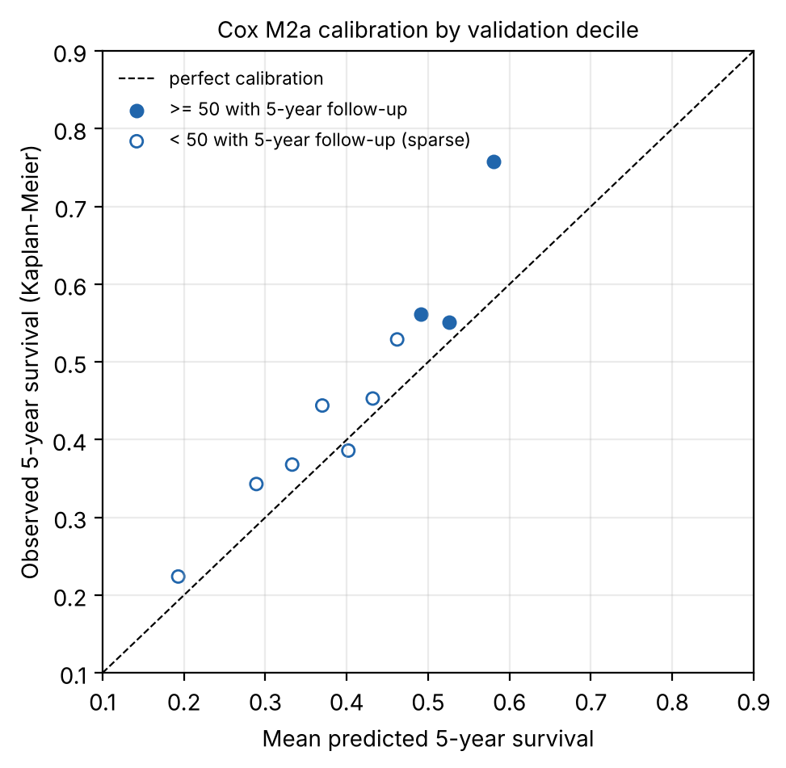
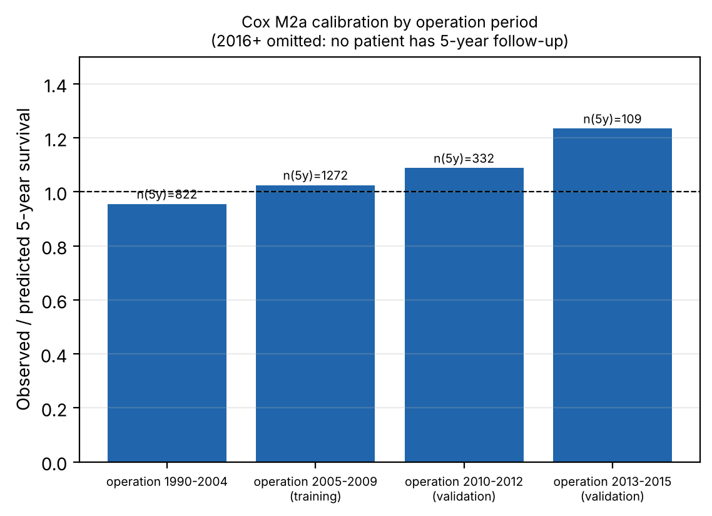
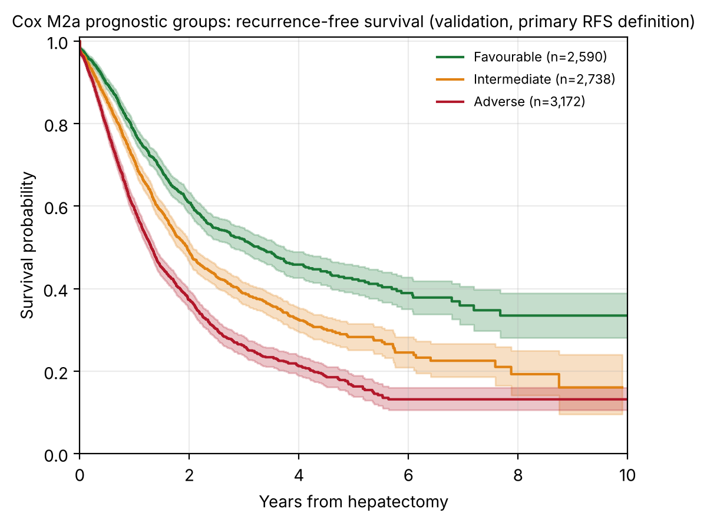

^1^School of Architecture, Computing and Engineering, University of East London, London E16 2RD, United Kingdom. ^2^NHS Grampian, Department of General Surgery, Aberdeen Royal Infirmary, Aberdeen AB25 2ZA, United Kingdom. ^3^East Lancashire Hospitals NHS Trust, Department of Hepatopancreaticobiliary Surgery, Burnley, Lancashire, United Kingdom. ^4^Centre Hépato-Biliaire, AP-HP Hôpital Universitaire Paul Brousse, Université Paris-Saclay, Villejuif, France.

\*Corresponding author: Farrah Aftab, MSc — f.aftab@uel.ac.uk

> **Draft for supervisor review (Paper 1).** Every number is taken from the locked v8 analysis and its supplementary outputs. Items marked **[TO CONFIRM]** need action by the authors or the registry before submission. The feedback-response summary, the reference verification record and the list of open questions accompany this draft.

# Abstract

**Background:** Colorectal liver metastases (CRLM) remain a major cause of colorectal cancer death. Established prognostic scores were derived from older, mainly single-centre cohorts, and their discrimination in contemporary practice is uncertain. We developed and temporally validated a postoperative survival model and three prognostic groups in an international registry.

**Methods:** Retrospective analysis of the LiverMetSurvey registry. The analytic cohort comprised 17,262 patients who underwent hepatectomy with complete TNM staging. Patients operated in 2009 or earlier (n = 8,463) formed the development cohort, and patients operated in 2010 or later (n = 8,799) the temporal validation cohort. A stratified Cox model (strata: sex, synchronous presentation and M-stage) used TNM stage, age, interval from primary diagnosis to liver metastasis, and number and size of metastases. Prognostic groups were defined by training-era tertiles of predicted 5-year survival and applied unchanged to validation patients. Performance was assessed by Harrell's C-index, time-dependent AUC, Brier score, calibration and Kaplan–Meier separation.

**Results:** The Favourable (n = 2,662), Intermediate (n = 2,824) and Adverse (n = 3,313) groups had validation median overall survival of 7.38, 4.44 and 3.18 years (log-rank p = 2 × 10⁻⁵²). The validation C-index was 0.622 (95% CI 0.608–0.637) and the integrated Brier score over 1–7 years was 0.075. Predicted 5-year survival was lower than observed (40.8% vs 46.6%), so the model under-predicted survival in validation. A model without TNM gave a C-index of 0.599 on the same patients. Median recurrence-free survival was 2.03 years (95% CI 1.98–2.09).

**Conclusions:** A stratified Cox model using routinely recorded variables separated three prognostic groups that remained distinct in temporal validation. Discrimination was modest, survival was under-predicted in more recent patients, and patients with incomplete staging differed systematically, so absolute survival estimates require recalibration before clinical use.

**Keywords:** colorectal liver metastases; prognostic model; Cox regression; survival analysis; temporal validation; calibration; surgical oncology

# Introduction

Colorectal cancer accounts for about 10% of cancer diagnoses worldwide, and hepatic metastases develop in roughly half of patients with the disease [CITATION NEEDED]. Resection of colorectal liver metastases, with or without perioperative chemotherapy, is the main opportunity for long-term survival, yet outcomes vary widely and are difficult to predict for an individual patient. Prognostic information guides selection for surgery, the intensity of follow-up and the design of trials.

The Fong Clinical Risk Score, derived from a single-centre cohort of 1,001 consecutive resections, has been the most widely used benchmark for recurrence after hepatectomy [1]. Its threshold-based summation of clinicopathological items may not capture interactions among tumour variables, and its derivation predates contemporary systemic therapy. Subsequent scores have added biology: the GAME score combines KRAS status, carcinoembryonic antigen, nodal status, tumour burden and extrahepatic disease, and in its derivation cohort separated patients with 5-year overall survival of 11% (high risk) from 73.4% (low risk) [2] **[TO VERIFY: these two survival figures must be checked against the original article]**. A systematic review and meta-analysis of prognostic scores for liver resection in colorectal metastases published in *Cancers* in 2026 reported that existing scores have limited performance, heterogeneous reporting and methodological pitfalls [3]. External validation of established scores has been reported in nationwide cohorts with modest results [4].

Two gaps remain. First, many models predict a binary outcome or report discrimination without calibration, so the time course of prognosis is lost and absolute predictions cannot be checked. Second, few studies have validated a prognostic tool in a temporally later cohort using a model fixed before validation. Reporting standards for prediction models now require explicit description of the development and validation design, predictor handling, calibration and clinical use [5,6]. Risk of bias in prediction-model studies can be assessed with PROBAST, and its update for artificial-intelligence models, PROBAST+AI, was published in 2025 [7].

The LiverMetSurvey registry is an international, prospectively maintained database of resected patients, with TNM staging and dated outcomes. We aimed to: (1) develop a stratified Cox survival model using routinely recorded TNM and clinical variables; (2) derive three prognostic groups (Favourable, Intermediate, Adverse) from training-era predicted 5-year survival and apply them unchanged to later patients; (3) evaluate discrimination, calibration and separation in temporal validation; (4) examine recurrence-free survival and the sensitivity of findings to date conventions, death-date handling, duplicate records and the omission of metastasis count and size; and (5) compare performance with established scores on identical patients where the variables allow. We do not report treatment-associated survival in this paper; that analysis is planned separately because the registry does not yet support it.

# Methods

## Study design and reporting

This was a retrospective cohort study of the LiverMetSurvey registry, a prospectively maintained, web-based database of patients with colorectal liver metastases established in 2004. The study followed the STROBE statement for observational studies [8] and the TRIPOD statement for multivariable prediction models [5]; the TRIPOD+AI extension [6] was consulted because it updates the reporting items for regression-based models as well as machine learning. The model is a regression model, so TRIPOD is the primary reporting standard. The completed checklists are supplied with the submission (Supplementary Material S9). Analyses were run on the raw registry workbooks through a single scripted notebook; SHA-256 checksums of the workbooks were recorded to confirm that the source files were unchanged.

## Participants and data sources

Eligibility required hepatectomy recorded; an operation year and month; a vital status and last-news date on or after the operation date; and either positive follow-up or death. Of 29,565 registry records, 586 were not recorded as eligible, 2,302 had no hepatectomy recorded, 85 had no operation date, 321 had no vital status or last-news date, 85 had inconsistent chronology and 92 had neither follow-up nor death. Of the 26,094 patients remaining, 8,832 (33.8%) had incomplete TNM staging and were excluded from the analytic cohort, leaving 17,262 patients (Figure 1). Missing components were recorded as not determined (ND) or left blank; the excluded patients are described in Supplementary Tables S1, S2 and S5.

Operation dates recorded to year and month only were assigned the 15th of the month (primary rule). The first-day and last-day-of-month rules were used as sensitivity analyses.

**Registry description [TO CONFIRM].** The original manuscript describes the registry as spanning 63 countries and 242 contributing centres. The analysis extract contains 54 country codes and 288 site codes. The discrepancy must be reconciled with the registry coordinators before submission; the reported numbers are the extract's.

## Outcomes and predictors

* **Outcome:** overall survival from hepatectomy to death from any cause or to the last-news date. Follow-up was capped at 15 years. No deaths in the analytic cohort occurred after 4 July 2020 (checked).
* **Recurrence-free survival (secondary):** time from hepatectomy to the earliest dated recurrence after operation, or to death. Recurrences dated before operation were excluded. Undated recurrences were censored in the primary analysis and handled by three alternative rules.
* **Predictors** (all recorded before or at operation): TNM stage (T1–2, T3, T4; N0, N1, N2; M0, M1, using the AJCC categories [9,10] with sub-categories collapsed); age at operation (per 10 years); sex; synchronous presentation; interval from primary diagnosis to liver metastasis (per 12 months; 0 for synchronous presentation; missing when the date was unknown, negative or after operation); number of liver metastases (per additional lesion); and recorded metastasis size (per 10 mm). Missing count and size were handled with missing-indicator variables and training-era medians. No multiple imputation was used for the primary model.
* **Timing of predictors [TO CONFIRM].** The registry data dictionary was not available for this analysis. Whether metastasis count and size were recorded before or after any preoperative treatment cannot be confirmed from the data; this is discussed in the Limitations.

## Data quality, duplicate records and sensitivity analyses

The registry has no patient-level identifier: the study identifier is constant and the subject identifier is blank. Records were screened for duplicates using every analysis column together with country, site, centre and patient number. An identical-content pair is two records with identical values in every analysis column. A probable duplicate additionally shares birth date and operation date and has at least 20 non-blank fields. Twenty-three identical-content pairs (46 records) were identified, of which 16 met the probable-duplicate rule. The primary analysis retains all records. Probable duplicates were removed only in a sensitivity analysis, and a broader sensitivity analysis removed later records sharing birth date, operation date and sex. No record was permanently removed, pending confirmation from the registry coordinators.

Other sensitivity analyses were: first-day and month-end rules for partial operation dates; same-day deaths (operation date equal to last-news date, status deceased) assigned half a day, one day, a quarter day, or excluded, and handled with or without an explicit death flag; a pre-operative-only model without metastasis count and size; complete-case and multiple-imputation analyses of carcinoembryonic antigen (CEA); four RFS handling rules for undated recurrences; and a recalibrated baseline hazard estimated from 2005–2009 training patients with coefficients unchanged.

## Model development

Patients operated in 2009 or earlier formed the development cohort; patients operated in 2010 or later formed the temporal validation cohort. Validation data were used only to evaluate fixed models, cut-points and rules. No model was chosen by its C-index.

Three candidate models were compared on identical patients: **M1**, stratified by sex and synchronous presentation with M-stage as a covariate; **M2a**, stratified by sex, synchronous presentation and M-stage; and **M2b**, as M1 with a time-varying M-stage effect split at 2 years. The selection rule was applied to training-only data before validation results were used: choose the simplest candidate whose Schoenfeld tests [11] for all constant terms have p > 0.05. M1 failed for M-stage (p = 0.031); M2a passed for all constant terms (smallest p = 0.18) and was selected. The time-varying M-stage effect in M2b was not significant (p = 0.21). Baseline hazards were estimated with a piecewise Breslow method [12] from training patients only, so that survival can be predicted at any time.

The coefficients of the selected model are given in Table 3 and Supplementary Material S3. Sample size was ample for the number of predictors: the development cohort contains 4,675 deaths, far above the number needed for the 11 candidate terms in the final model.

## Prognostic groups

Patients were assigned to groups by predicted 5-year survival, with cut-points set as tertiles in the training cohort and applied unchanged to validation:

* Favourable: predicted 5-year survival ≥ 0.4756
* Intermediate: 0.3793 ≤ predicted 5-year survival < 0.4756
* Adverse: predicted 5-year survival < 0.3793

Each group contains one third of the development cohort (n = 2,821). Separation was tested with log-rank tests and an ordinal C-index. Stability of group assignment was assessed by refitting the model on 100 bootstrap samples and comparing the resulting assignments with the primary assignment (Cohen's κ).

## Performance, calibration and censoring

Harrell's C-index [13] was calculated in each cohort, with a 300-resample bootstrap interval in validation. Time-dependent AUC at 1, 3 and 5 years, Brier scores at 1, 3 and 5 years [14], and the integrated Brier score over 1–7 years were computed in validation from training-based predictions. Calibration was assessed by comparing mean predicted survival with Kaplan–Meier survival at 1, 3 and 5 years (observed/expected ratio, with bootstrap intervals), by a calibration slope, by validation decile and by operation period. Decile and period estimates were flagged as sparse when fewer than 50 patients had 5 years of follow-up.

Censoring was handled by the Kaplan–Meier and Cox methods, which account for patients alive at last contact. Median follow-up was estimated by the reverse Kaplan–Meier method: 5.89 years in the development cohort and 1.47 years in the validation cohort. Because validation follow-up is short, the number of validation patients who can be evaluated falls with horizon (Table 5), and this is reported explicitly.

## Clinical comparison with established scores

The Fong Clinical Risk Score [1] and a Nordlinger-type score [15] were compared with the selected model on identical patients. The Fong subset comprised patients with CEA recorded; the Nordlinger-type subset comprised patients with age, T stage, N stage and interval data. The Fong score was computed from its five items (node-positive, interval < 12 months, more than one metastasis, size > 50 mm, CEA > 200 ng/mL). The Nordlinger-type score is an approximation built from four items available in this registry (age ≥ 60, T4, node-positive, interval < 12 months) and is not the published model. The GAME score [2] was not reproduced because KRAS status is not recorded in the registry for most patients (recorded for 2.3%), and the Tumour Burden Score was not reproduced because the cut-offs differ between published studies and the registry's size variable is the largest recorded value rather than a validated maximum diameter.

## Software and reproducibility

Random seed was 42. Software: pandas 2.3.3, NumPy 2.5.3, lifelines 0.30.3, scikit-survival 0.28.0, scikit-learn 1.9.1, pyarrow 26.0.0 and python-calamine 0.8.3, on Python 3.13.16. The notebook was executed end to end; all 15 code cells ran without errors. A reproduction check against the previously validated analysis passed for all ten key quantities (Supplementary Material S7). The primary analysis outputs are unchanged from the validated version. The analysis code is available at https://github.com/FarrahAftab/LiverMets.

# Results

## Study population

Of 29,565 registry records, 26,094 met the eligibility criteria and 17,262 had complete TNM staging (Figure 1). The development cohort contained 8,463 patients (4,675 deaths) and the validation cohort 8,799 patients (1,916 deaths). The median age was 63.4 years (IQR 55.7–70.6), 61.8% were male, and 57.8% had M1 disease. Table 1 gives the baseline characteristics by period. The validation cohort had a higher proportion of M1 disease and of four or more metastases, and shorter follow-up.

**Figure 1.** STROBE patient flow. Counts are from the executed notebook (Supplementary Tables S1 and S5 give the excluded patients).

| Characteristic | Total (n = 17,262) | Development (≤2009; n = 8,463) | Validation (≥2010; n = 8,799) |
|---|---|---|---|
| Patients | 17,262 | 8,463 | 8,799 |
| Age at operation, years, median (IQR) | 63.4 (55.7-70.6) | 62.9 (55.2-69.9) | 64.0 (56.2-71.4) |
| Male sex, n (%) | 10,676 (61.8) | 5,204 (61.5) | 5,472 (62.2) |
| T stage, n (%) |  |  |  |
| &emsp;T1-2 | 491 (2.8) | 186 (2.2) | 305 (3.5) |
| &emsp;T3 | 13,023 (75.4) | 6,592 (77.9) | 6,431 (73.1) |
| &emsp;T4 | 3,748 (21.7) | 1,685 (19.9) | 2,063 (23.4) |
| N stage, n (%) |  |  |  |
| &emsp;N0 | 5,709 (33.1) | 2,827 (33.4) | 2,882 (32.8) |
| &emsp;N1 | 6,784 (39.3) | 3,337 (39.4) | 3,447 (39.2) |
| &emsp;N2 | 4,769 (27.6) | 2,299 (27.2) | 2,470 (28.1) |
| M stage, n (%) |  |  |  |
| &emsp;M0 | 7,277 (42.2) | 3,686 (43.6) | 3,591 (40.8) |
| &emsp;M1 | 9,985 (57.8) | 4,777 (56.4) | 5,208 (59.2) |
| Synchronous presentation, n (%) | 10,015 (58.0) | 4,776 (56.4) | 5,239 (59.5) |
| Synchrony not recorded, n (%) | 198 (1.1) | 138 (1.6) | 60 (0.7) |
| Metachronous presentation, n (%) | 7,049 (40.8) | 3,549 (41.9) | 3,500 (39.8) |
| Interval primary to liver metastasis, months, median (IQR; metachronous only) | 16.0 (9.8-26.9) | 16.3 (10.1-27.5) | 15.8 (9.4-26.3) |
| Metachronous, interval unavailable (metastasis date unknown or after operation), n (%) | 3,941 (55.9) | 2,154 (60.7) | 1,787 (51.1) |
| Number of liver metastases, n (%) |  |  |  |
| &emsp;1 | 7,144 (41.4) | 3,626 (42.8) | 3,518 (40.0) |
| &emsp;2-3 | 5,332 (30.9) | 2,625 (31.0) | 2,707 (30.8) |
| &emsp;>=4 | 3,535 (20.5) | 1,600 (18.9) | 1,935 (22.0) |
| &emsp;Unknown | 1,251 (7.2) | 612 (7.2) | 639 (7.3) |
| Largest recorded metastasis, mm, median (IQR) | 30.0 (20.0-45.0) | 30.0 (20.0-48.0) | 29.0 (19.0-45.0) |
| Size missing, n (%) | 3,306 (19.2) | 1,344 (15.9) | 1,962 (22.3) |
| Pre-operative CEA recorded, n (%) | 11,364 (65.8) | 5,517 (65.2) | 5,847 (66.5) |
| Deaths recorded (PATSTATC = Deceased), n (%) | 6,601 (38.2) | 4,685 (55.4) | 1,916 (21.8) |
| Deaths inside the 15-year analysis window (events), n (%) | 6,591 (38.2) | 4,675 (55.2) | 1,916 (21.8) |
| Patients with follow-up beyond 15 years (censored; not deaths), n | 69 | 69 | 0 |
| Median follow-up, years (reverse Kaplan-Meier) | 3.16 | 5.89 | 1.47 |
| Median overall survival, years (KM, 95% CI not shown) | 4.15 | 3.97 | 4.50 |

**Table 1.** Baseline characteristics of the analytic cohort (17,262) by development (operated 2009 or earlier) and temporal validation (operated 2010 or later) period. Deaths are reported as recorded and as events inside the 15-year window.

## Patients excluded for incomplete staging

Of 26,094 patients meeting the eligibility criteria, 8,832 (33.8%) had incomplete staging. The missing components were T, N and M together in 3,041 patients (11.7%), T alone in 2,324 (8.9%), M alone in 1,358 (5.2%), T and N in 1,220 (4.7%), T and M in 418 (1.6%), N alone in 402 (1.5%) and N and M in 69 (0.3%) (Supplementary Table S2). Exclusion declined with time: 69.7% of operations in 1990–1999 were excluded, falling to 24.4% in 2015–2020. Of 259 contributing sites (registry site codes) with patients meeting the criteria, 57 had no excluded patients, 11 had only excluded patients and 34 had at least half of their patients excluded. Excluded patients were less often synchronous, had larger recorded metastases (median 35 vs 30 mm) and were operated earlier (median year 2007 vs 2010) (Supplementary Table S1). Their 5-year survival was lower in the development era and higher in the validation era (Supplementary Table S5). Observed/expected survival relative to a model without TNM was 1.03 and 1.16 for included patients in the development and validation eras, and 0.96 and 1.27 for excluded patients.

These patterns are difficult to reconcile with missingness that depends only on the recorded covariates, and they raise concern about selection bias. The direction of any bias cannot be determined from the registry.

## Model performance

The three candidate models gave near-identical discrimination and calibration on identical patients (Table 2). In validation, the selected model had a C-index of 0.622 (95% CI 0.608–0.637), against 0.622 for M1 and 0.622 for M2b. Time-dependent AUC in validation was 0.639 at 1 year, 0.653 at 3 years and 0.675 at 5 years. The Brier scores at 1, 3 and 5 years were 0.060, 0.101 and 0.065, and the integrated Brier score over 1–7 years was 0.075. Discrimination is therefore modest, and the model's value lies mainly in the stratification and calibration reported below.

**Table 2.** Candidate models on identical patients (validation n = 8,799).

| Model | Validation C-index | 95% CI | tAUC 1/3/5 y | Brier 1/3/5 y | IBS 1–7 y | O/E 5 y |
|---|---|---|---|---|---|---|
| M1 stratified sex x synchronous | 0.6218 | 0.606-0.636 | 0.638/0.652/0.674 | 0.0604/0.1011/0.0651 | 0.0752 | 1.141 |
| M2a stratified sex x synchronous x M-stage | 0.6216 | 0.608-0.637 | 0.639/0.653/0.675 | 0.0604/0.101/0.0651 | 0.0752 | 1.142 |
| M2b stratified sex x synchronous, time-varying M-stage | 0.6219 | 0.609-0.637 | 0.638/0.652/0.674 | 0.0604/0.101/0.0651 | 0.0752 | 1.14 |

**Table 3.** Coefficients of the selected model (M2a), fitted on the development cohort. Hazard ratios are within strata defined by sex, synchronous presentation and M-stage. Source: `P1_model_coefficients.csv`.

| Term | Coefficient (β) | HR | 95% CI | p |
|---|---|---|---|---|
| T3 vs T1-2 | 0.1173 | 1.124 | 0.908–1.393 | 0.283 |
| T4 vs T1-2 | 0.3101 | 1.364 | 1.093–1.701 | 0.006 |
| N1 vs N0 | 0.2486 | 1.282 | 1.195–1.376 | <0.001 |
| N2 vs N0 | 0.4858 | 1.625 | 1.505–1.755 | <0.001 |
| Age, per 10 years | 0.1234 | 1.131 | 1.098–1.166 | <0.001 |
| Interval primary to liver metastasis, per 12 months (0 if synchronous) | -0.0183 | 0.982 | 0.939–1.027 | 0.420 |
| Number of liver metastases, per additional lesion | 0.0623 | 1.064 | 1.054–1.075 | <0.001 |
| Largest metastasis, per 10 mm | 0.0312 | 1.032 | 1.022–1.042 | <0.001 |
| Interval unavailable (indicator) | -0.0707 | 0.932 | 0.827–1.05 | 0.245 |
| Metastasis count unavailable (indicator) | 0.193 | 1.213 | 1.079–1.363 | 0.001 |
| Metastasis size unavailable (indicator) | -0.0165 | 0.984 | 0.904–1.07 | 0.703 |

## Proportional hazards

The Schoenfeld test was applied to each constant term in the training cohort. In M1, the M-stage term violated the proportional hazards assumption (p = 0.031); in M2a, which places M-stage in the strata, all constant terms satisfied it (smallest p = 0.18). The time-varying M-stage model (M2b) showed no significant change in the M-stage effect after 2 years (p = 0.21). The stratified specification was therefore retained, and the choice was made by the pre-specified rule rather than by discrimination.

## Prognostic groups

The three groups separated overall survival clearly in both cohorts (Table 4; Figures 2 and 3). In validation, median overall survival was 7.38 years (95% CI 6.14 to not estimable) in the Favourable group, 4.44 years (4.14–4.88) in the Intermediate group and 3.18 years (2.97–3.38) in the Adverse group. Five-year survival by Kaplan–Meier was 62.9%, 45.4% and 34.3%. The log-rank p-value was 2 × 10⁻⁵² in validation and 1.4 × 10⁻⁷⁷ in development, and the ordinal C-index was 0.603. The bootstrap κ for assignment stability was 0.83 (95% range 0.78–0.89).

**Table 4.** Prognostic groups (M2a) with training-only cut-points and validation outcomes. Source: `F06_phenotypes_counts_survival_calibration.csv`.

| Group | Development n | Validation n | Validation deaths | Validation median OS, years (95% CI) | Validation 5-y KM survival | Development 5-y KM survival | Validation mean predicted 5-y survival |
|---|---|---|---|---|---|---|---|
| Favourable | 2821 | 2662 | 383 | 7.38 (6.14-NE) | 62.9% | 54.1% | 53.3% |
| Intermediate | 2821 | 2824 | 598 | 4.44 (4.14-4.88) | 45.4% | 41.9% | 42.8% |
| Adverse | 2821 | 3313 | 935 | 3.18 (2.97-3.38) | 34.3% | 30.7% | 30.4% |

**Figure 2.** Overall survival by prognostic group in the validation cohort (operated 2010 or later). Cut-points were derived in the development cohort.

## Calibration

Predicted 5-year survival was 40.8% against 46.6% observed (observed/expected 1.14, bootstrap interval 1.09–1.20; calibration slope 1.07). The model therefore under-predicted survival in validation at 5 years. The gap was small at 1 year (observed/expected 1.02, interval 1.01–1.02) and grew at 3 years (1.09, 1.06–1.12), so under-prediction increases with horizon (Table 5).

**Table 5.** Calibration and evaluability by horizon in the validation cohort (n = 8,799). Source: `G01_horizon_feasibility_validation.csv` and `G03_calibration_precision_by_horizon.csv`.

| Horizon, years | Evaluable n (%) | Deaths before horizon | Mean predicted survival | Observed KM survival (95% CI) | O/E (bootstrap 95% CI) |
|---|---|---|---|---|---|
| 1 | 5335 (60.6%) | 581 | 89.7% | 91.0% (90.3–91.7) | 1.01 (1.01–1.02) |
| 3 | 3118 (35.4%) | 1544 | 59.2% | 64.5% (63.0–66.1) | 1.09 (1.06–1.12) |
| 5 | 2289 (26.0%) | 1848 | 40.8% | 46.6% (44.4–48.7) | 1.14 (1.09–1.20) |

Across validation deciles of predicted 5-year survival, under-prediction was present in nine of ten deciles; the largest gap was in the most favourable decile (observed 75.8% against 58.0% predicted; Figure 4). The lower deciles contain fewer than 50 patients with 5 years of follow-up, so their observed values are imprecise. By operation period, the observed/expected ratio was 0.96 for 1990–2004, 1.03 for 2005–2009 (training), 1.09 for 2010–2012 and 1.23 for 2013–2015 (Figure 5). The 2013–2015 estimate rests on 109 patients with 5 years of follow-up, and no patient operated in 2016 or later had 5 years of follow-up, so calibration in that period cannot be assessed.

Re-estimating the baseline hazard from 2005–2009 patients, with coefficients unchanged, reduced the 5-year observed/expected ratio to 1.12 and kept 92% of patients in their primary group (κ 0.88). This reduces but does not remove the gap, so the primary model was not recalibrated.

**Figure 4.** Calibration by validation decile of predicted 5-year survival. Open markers: fewer than 50 patients with 5-year follow-up.

**Figure 5.** Observed/expected 5-year survival by operation period. The 2016 onward period is omitted because no patient had 5-year follow-up.

## Recurrence-free survival

Median RFS was 2.03 years (95% CI 1.98–2.09) in the primary analysis, in which dated recurrences and deaths were events and undated recurrences were censored, with 39.3% and 27.6% recurrence-free at 3 and 5 years (Figure 3). The alternative handling rules gave medians of 1.93 years (undated recurrences as events at last contact), 1.69 years (mid-interval) and 1.84 years (undated recurrences excluded). In the cohort, 5,324 patients had a dated recurrence after operation, 585 had a recurrence dated before operation (excluded) and 1,676 had a recurrence recorded without a usable date. Forty-one recurrences were dated after the last contact and were treated as undated.

**Figure 3.** Recurrence-free survival by prognostic group in the validation cohort (primary definition).

## Sensitivity analyses

**Table 6.** Sensitivity analyses (validation unless stated). Source: `F10`, `F13`, `F14`, `F19` and `F23`.

| Analysis | Validation C-index | Group agreement with primary | κ | Source / note |
|---|---|---|---|---|
| Primary (15th of month; same-day deaths half a day) | 0.6216 | — | — | Reference |
| First day of month for partial dates | 0.6214 | 99.7% | 0.996 | F10 |
| Month-end for partial dates | 0.6217 | 99.98% | 1.000 | F10 |
| Same-day deaths excluded (13) | 0.6221 | 99.6% | 0.994 | F10 |
| Same-day deaths without death flag excluded (7) | 0.6226 | 99.6% | 0.994 | F19 |
| Pre-operative-only model, M1 structure (no count/size) | 0.5913 (0.573–0.606) | — | — | F14 |
| Pre-operative-only model, selected M2a structure | 0.5905 (0.575–0.604) | — | — | F23 |
| CEA added, complete case (n = 5,847) | 0.628 → 0.648 | — | — | F13; CEA HR 1.16 (1.13–1.19) per log unit |
| CEA added, multiple imputation (10 draws) | 0.622 → 0.637 | — | — | F13; CEA HR 1.15 (1.13–1.18) |
| Baseline hazard re-estimated from 2005–2009 (coefficients fixed) | 0.6197 | 92.2% | 0.883 | F22; 5-y O/E 1.12 (from 1.14) |

Using the first day of the month rather than the 15th changed 0.3% of group assignments. Assigning same-day deaths half a day, one day or a quarter day gave identical phenotypes at the reported precision, and excluding the 13 same-day deaths in the cohort changed the validation C-index from 0.6216 to 0.6221. Of the 13 same-day deaths in the cohort, seven lacked an explicit death flag; excluding or censoring them changed the group assignment for about 0.4% of patients. The death flag was missing or "No" at every follow-up interval: among deceased analytic-cohort patients it was positive for 50% of deaths at 1–30 days, 73% at 31–365 days and 82% at 1–5 years.

Removing duplicates (Supplementary Table S3) left the validation C-index unchanged at 0.622. Removing the 6 second copies in the cohort left 5-year survival at 46.6% and reassigned 33 patients (0.2%); the broader removal of 37 later records sharing birth date, operation date and sex reassigned 138 patients (0.8%) and gave a 5-year survival of 46.7%. The prognostic groups are therefore robust to duplicate records, but the duplicates should be confirmed and removed in the final data.

## Comparison with established scores and a model without TNM

On identical validation patients, the selected model had a C-index of 0.639 in the Fong subset (n = 3,642; 914 deaths), against 0.591 for the Fong score, and 0.630 in the Nordlinger-type subset (n = 6,137; 1,396 deaths), against 0.583 for the Nordlinger-type approximation (Table 7). Observed/expected 5-year survival in these subsets was 1.19 and 1.16. These comparisons use registry approximations of the scores, so they indicate relative performance on this registry and do not establish the published models' performance.

**Table 7.** Validation C-index on identical patients (benchmark subsets). Source: `F16_identical_subset_comparison_calibration.csv`.

| Validation subset | n | Deaths | Selected model C-index | Observed/expected 5-y | Fong score C-index | Nordlinger-type C-index |
|---|---|---|---|---|---|---|
| All TNM-complete validation | 8799 | 1916 | 0.6216 | 1.142 | — | — |
| Fong CRS subset (CEA recorded) | 3642 | 914 | 0.6394 | 1.188 | 0.5912 | — |
| Nordlinger-type subset | 6137 | 1396 | 0.6303 | 1.155 | — | 0.583 |

Metastasis count and size are assumed to be known around operation. When they were removed (pre-operative-only model), the C-index fell to 0.591 (95% CI 0.573–0.606) in the M1 structure and 0.591 (0.575–0.604) in the selected M2a structure (Supplementary Table S4). A model without TNM staging, using age, sex, synchrony, interval, count and size, gave a C-index of 0.599 on the same 8,799 validation patients, a difference of 0.022 (95% CI 0.009–0.034) from the TNM model. On all 11,967 validation patients, including those with incomplete staging, the no-TNM model gave 0.597; this figure is not directly comparable with the TNM model because the populations differ (Supplementary Table S4).

## Carcinoembryonic antigen

In the complete-case analysis (5,847 validation patients), CEA was associated with mortality (hazard ratio 1.16 per log unit, 95% CI 1.13–1.19), and adding it raised the C-index from 0.628 to 0.648. Multiple imputation (10 draws) gave a hazard ratio of 1.15 (1.13–1.18) and a C-index change from 0.622 to 0.637. CEA was missing for about one third of patients, so it was not included in the primary model.

# Discussion

## Principal findings

In this international registry, a stratified Cox model using TNM stage, age, the interval from primary diagnosis to liver metastasis, and the number and size of metastases separated patients into three prognostic groups whose outcomes remained distinct in a later temporal validation cohort. The Favourable group had a 5-year survival of 62.9%, the Intermediate group 45.4% and the Adverse group 34.3%. The groups were fixed in training and applied unchanged, and their assignment was stable on bootstrap refitting (κ 0.83).

## Discrimination in context

Discrimination was modest, with a validation C-index of 0.622. This is an honest result for a model built on routinely recorded variables, and it should be read against the broader literature: a 2026 systematic review reported limited performance and heterogeneous reporting for existing liver-resection scores [3], and external validation of the Fong score in a nationwide cohort reported modest performance [4] **[TO VERIFY: wording and authors of ref 4 to be checked]**. Our benchmark comparisons suggest that the selected model discriminates better than our registry approximations of the Fong and Nordlinger-type scores on identical patients, but these are approximations, and we do not claim superiority over published scores. The GAME score, which adds KRAS status and extrahepatic disease, was designed for preoperative selection and cannot be reconstructed from this registry [2]. Its published group thresholds also differ between sources, so a direct comparison requires the original definitions.

The model's clinical contribution is therefore not high discrimination. It is a survival-based stratification that gives predicted survival at 1, 3 and 5 years, uses only routinely recorded variables, is fixed before validation, and reports its calibration limits.

## Calibration and horizon

The model under-predicted survival in the validation era, most clearly at 5 years (observed 46.6% against predicted 40.8%). The gap was small at 1 year and grew with horizon, which suggests that the baseline hazard does not fully capture the longer-term outcomes of recent patients. Re-estimating the baseline from 2005–2009 patients reduced but did not remove the gap. Absolute survival estimates should therefore not be quoted without recalibration on contemporary data. The 5-year benchmark is retained for comparability with published scores, but only 26% of validation patients can be evaluated at that horizon, so we also report 1- and 3-year performance (Table 5).

## Proportional hazards and censoring

The stratified specification removes the proportional hazards violation for M-stage detected in the simpler model, and the constant terms in the selected model satisfy the Schoenfeld tests in training. We did not formally test proportional hazards within the validation cohort or for the time-varying effects of all covariates, which is a limitation. Censoring is substantial in the validation cohort because of short follow-up (median 1.47 years), and the calibration and RFS estimates at longer horizons rest on a small number of patients at risk. Follow-up is capped at 15 years, with 69 patients having follow-up beyond that point (10 of whom died).

## Selection and missing staging

Patients with incomplete TNM staging (33.8% of those meeting the eligibility criteria) differed from the analytic cohort in period, centre, synchrony and metastasis size. Their outcomes differed from those predicted by a no-TNM model, in opposite directions in the two eras. The analytic cohort is therefore the population in which TNM-based prediction is valid, but it is not representative of all resected patients, and the results should not be extended to patients with incomplete staging without caution.

## Relation to earlier work

An earlier analysis of this registry used binary classification and classification trees, and the risk groups in this paper replace it. The use of a survival model rather than a binary classifier retains information about the timing and censoring of outcomes, which is the reason for the change.

## Future research

A treatment-associated survival analysis, including perioperative chemotherapy, is planned as a separate study. Pre-operative chemotherapy must be defined by timing relative to operation, its relation to the metastasis count and size must be confirmed, and important confounders such as performance status, liver function and KRAS status must be available before any treatment comparison can be interpreted. External validation in independent contemporary cohorts, and a model that incorporates molecular markers, are required before clinical implementation.

# Limitations

1. **Discrimination.** The C-index of 0.622 is modest. The groups rank patients but do not identify individual outcomes with high precision.
2. **Calibration.** The model under-predicts survival in validation, most clearly at 5 years. The primary model was not recalibrated; recalibration on contemporary data is required.
3. **Temporal validation and follow-up.** Validation is temporal within a single registry, with median follow-up of 1.47 years. No external validation was performed. Long-term calibration in recent patients cannot be assessed.
4. **Predictor timing.** Metastasis count and size are assumed to be known around operation. Their recording time relative to any preoperative treatment could not be confirmed from the registry data dictionary, which was not available. The pre-operative and resected counts agreed for 62% of patients with both recorded.
5. **Missing and selected data.** One third of the eligible population was excluded for incomplete TNM staging, and the excluded patients differ systematically. Missing-at-random cannot be verified. Interval, count and size are missing for many patients and are handled by indicator variables rather than imputation.
6. **Death and recurrence data.** In the full registry extract, 11,594 patients are recorded as deceased, and 3,074 of them lack an explicit death flag, so their survival times rest on the last-news date. (Within the analytic cohort, the 6,601 recorded deaths are the figure relevant to the models.) Recurrence dates are missing for 1,676 recurrences, so RFS is secondary.
7. **Duplicates.** Sixteen probable duplicate pairs and a set of near-duplicates in the cohort await registry confirmation. The sensitivity analyses show that the conclusions do not change, but the registry should resolve them.
8. **Benchmarks.** The Fong and Nordlinger-type comparisons use approximations, and the GAME and Tumour Burden Scores could not be reproduced from registry variables.
9. **Missing covariates.** Performance status, comorbidity, liver function and KRAS status are not available for most patients, so the model cannot account for them.
10. **Registry description.** The number of countries and centres described in the original manuscript must be reconciled with the analysis extract before submission.
11. **Generalisability.** The analytic cohort over-represents recent and synchronous operations (Supplementary Table S1).

# Conclusions

In an international registry of patients undergoing hepatic resection for colorectal liver metastases, a stratified Cox model using routinely recorded TNM, clinical and operative variables produced three prognostic groups with clearly different survival. The groups were fixed in training and remained distinct in temporal validation, with modest discrimination and a calibration gap that increases with horizon. The model's value lies in its transparent, survival-based stratification and in the explicit reporting of its limits. Absolute survival predictions require recalibration on contemporary data, and prospective or external validation is needed before clinical use.

# Declarations

**Funding:** No specific funding was received for this study.

**Conflicts of Interest:** The authors declare that they have no competing interests relevant to this work.

**Author Contributions:** F.A. conceived and designed the study, performed the statistical analyses, interpreted the data, and drafted the manuscript. M.A.G. supervised the study, contributed to the study design and interpretation of the findings, and critically revised the manuscript. M.B. provided clinical expertise, contributed to the interpretation of the clinical findings, and critically reviewed the manuscript. All authors read and approved the final manuscript. **[TO CONFIRM]** The original statement does not record a contribution for R. Adam. The authors must confirm each author's contribution before submission; no contribution has been added on their behalf.

**Data Availability:** The data analysed in this study were obtained from the LiverMetSurvey international registry. Access to the registry is governed by the LiverMetSurvey collaboration and is subject to institutional approval, data-sharing agreements, and applicable ethical requirements. Requests for data access should be directed to the registry coordinating centre. The analysis code is available at https://github.com/FarrahAftab/LiverMets.

**Ethics Approval:** This study was conducted in accordance with the principles of the Declaration of Helsinki. The study involved secondary analysis of anonymised data obtained from the LiverMetSurvey international registry. The registry contains de-identified clinical data collected in accordance with local ethical and regulatory requirements at participating centres. Owing to the retrospective analysis of anonymised registry data, the requirement for individual informed consent was waived where permitted by applicable regulations. Institutional ethical review was conducted in accordance with University of East London research governance requirements. **[TO CONFIRM]** No approval reference number is given in the original statement, and it is not clear whether a formal approval was issued for this analysis. The authors must supply the approval reference, or state that it does not apply, before submission.

# References

1. Fong Y, Fortner J, Sun RL, Brennan MF, Blumgart LH. Clinical score for predicting recurrence after hepatic resection for metastatic colorectal cancer: analysis of 1001 consecutive cases. *Ann Surg*. 1999;230(3):309–318. [Verified in prior search; confirm page range]
2. Margonis GA, Sasaki K, Gholami S, et al. Genetic and morphological evaluation (GAME) score for colorectal liver metastases. *Ann Surg* (2018). [Verified in prior search; confirm volume and pages] **[TO VERIFY survival figures cited in text]**
3. Systematic review and meta-analysis of prognostic scores for liver resection of colorectal metastases. *Cancers* (2026). [TO VERIFY: title, authors and score count; match identified but not fully confirmed]
4. Nationwide validation of the Fong clinical risk score after liver resection for colorectal metastases (PMC9139295). [TO VERIFY: authors, journal and year]
5. Collins GS, Reitsma JB, Altman DG, Moons KGM. Transparent Reporting of a multivariable prediction model for Individual Prognosis or Diagnosis (TRIPOD): the TRIPOD statement. *BMJ*. 2015;350:g7594.
6. Collins GS, et al. TRIPOD+AI statement: updated guidance for reporting clinical prediction models that use regression or machine learning methods. *BMJ*. 2024. [TO VERIFY: author list and volume]
7. Moons KGM, Damen JAA, Kaul T, et al. PROBAST+AI: an updated quality, risk of bias, and applicability assessment tool for prediction models using regression or artificial intelligence methods. *BMJ*. 2025. [Verified in prior search; confirm author list]
8. von Elm E, Altman DG, Egger M, et al. The Strengthening the Reporting of Observational Studies in Epidemiology (STROBE) statement. *Lancet*. 2007;370(9596):1453–1457.
9. Edge SB, Byrd DR, Compton CC, et al., eds. *AJCC Cancer Staging Manual*. 7th ed. Springer; 2010. [TO VERIFY edition used in the registry]
10. Amin MB, Edge SB, Greene FL, et al., eds. *AJCC Cancer Staging Manual*. 8th ed. Springer; 2017. [TO VERIFY]
11. Schoenfeld D. Partial residuals for the proportional hazards regression model. *Biometrika*. 1982;69(1):239–241.
12. Breslow NE. Discussion of Professor Cox's paper. *J R Stat Soc B*. 1972. [TO VERIFY citation]
13. Harrell FE Jr, Califf RM, Pryor DB, Lee KL, Rosati RA. Evaluating the yield of medical tests. *JAMA*. 1982;247(18):2543–2546. [TO VERIFY: C-index reference]
14. Graf E, Schmoor C, Sauerbrei W, Schumacher M. Assessment and comparison of prognostic classification schemes for survival data. *Stat Med*. 1999;18(17–18):2529–2545.
15. Nordlinger B, et al. Nordlinger-type prognostic score for colorectal liver metastases. [TO VERIFY: citation and original score definition; the approximation used here is four items only]

**[TO VERIFY]** Reference details below were checked in this revision where a source was found; items marked [TO VERIFY] could not be fully confirmed and must be checked against the original article before submission.

# Figure and table index

| Item | Source | Status |
|---|---|---|
| Figure 1 STROBE flow | `results/final_v7/figures/FIG1_STROBE_flow_v7.png` | Generated from the executed notebook |
| Figures 2–5 | `results/final_v7/figures/COX_01–04*.png` | Generated from the executed notebook |
| Table 1 Baseline characteristics | `F31` | From the executed notebook |
| Table 2 Candidate models | `F02` | From the executed notebook |
| Table 3 Model coefficients | `P1_model_coefficients.csv` | Locked model, reported |
| Table 4 Prognostic groups | `F06` | From the executed notebook |
| Table 5 Horizons | `G01`, `G03` | Feasibility computation on the locked model |
| Table 6 Sensitivity analyses | `F10`, `F13`, `F14`, `F19`, `F23` | From the executed notebook |
| Table 7 Benchmarks | `F16` | From the executed notebook |
| Supplementary S1–S9 | See Supplementary Material | See supplementary index |
