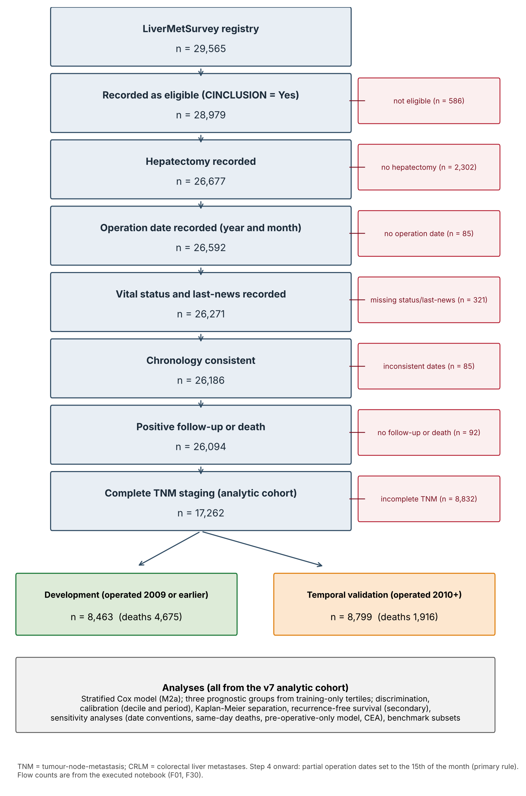
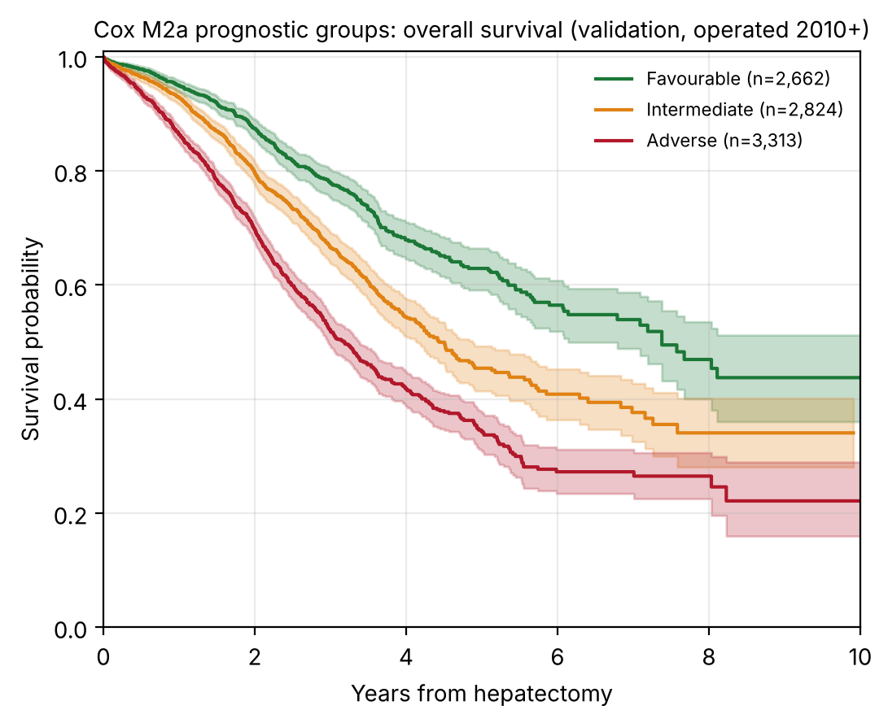

^1^School of Architecture, Computing and Engineering, University of East London, London E16 2RD, United Kingdom. ^2^NHS Grampian, Department of General Surgery, Aberdeen Royal Infirmary, Aberdeen AB25 2ZA, United Kingdom. ^3^East Lancashire Hospitals NHS Trust, Department of Hepatopancreaticobiliary Surgery, Burnley, Lancashire, United Kingdom. ^4^Centre Hépato-Biliaire, AP-HP Hôpital Universitaire Paul Brousse, Université Paris-Saclay, Villejuif, France.

\*Corresponding author: Farrah Aftab, MSc — f.aftab@uel.ac.uk

> **Draft for supervisor review.** Items marked **[TO CONFIRM]**, **[TO VERIFY]** or **[CITATION NEEDED]** are unresolved and are listed separately in the supervisor-confirmation note.

# Abstract

**Background:** Colorectal liver metastases (CRLM) are a major cause of colorectal cancer death. Established prognostic scores were mostly derived from older, single-centre cohorts, and their performance in contemporary practice is uncertain.

**Methods:** Retrospective analysis of the LiverMetSurvey registry. The analytic cohort comprised 17,262 patients undergoing hepatectomy with complete TNM staging, divided by operation year into a development cohort (≤2009; n = 8,463) and a temporal validation cohort (≥2010; n = 8,799). A stratified Cox model (strata: sex, synchronous presentation and M-stage) used TNM stage, age, interval to liver metastasis, and number and size of metastases. Three prognostic groups were defined by training-era tertiles of predicted 5-year survival and applied unchanged to validation patients.

**Results:** Validation median overall survival was 7.38, 4.44 and 3.18 years in the Favourable (n = 2,662), Intermediate (n = 2,824) and Adverse (n = 3,313) groups (log-rank p = 2 × 10⁻⁵²). The C-index was 0.622 (95% CI 0.608–0.637). Predicted 5-year survival was 40.8% against 46.6% observed. Without TNM stage the C-index was 0.599 in the same patients.

**Conclusions:** A stratified Cox model using routinely recorded variables separated three prognostic groups that remained distinct in temporal validation. Discrimination was modest and survival was under-predicted in recent patients, so absolute predictions need recalibration before clinical use.

**Keywords:** colorectal liver metastases; prognostic model; survival analysis; temporal validation; calibration

# Introduction

Hepatic resection is the main opportunity for long-term survival in patients with colorectal liver metastases, yet outcomes vary widely and are hard to predict for an individual patient [CITATION NEEDED: incidence of liver metastases]. Prognostic information informs patient selection, follow-up and trial design.

The Fong Clinical Risk Score, derived from 1,001 consecutive resections at a single centre, is the most widely used benchmark [1]. It counts five preoperative criteria and predates contemporary systemic therapy. The GAME score adds KRAS status to clinicopathological variables and separated patients with 5-year overall survival of 11% from 73% in its derivation cohort [2] [TO VERIFY: survival figures against the original article]. A 2026 systematic review and meta-analysis of liver-resection prognostic scores reported limited performance and heterogeneous reporting [3]. In a nationwide Dutch cohort, the Fong score had a C-index of 0.577 and GAME 0.596 [4].

Two gaps remain. Many models report discrimination without calibration, so absolute predictions cannot be checked. Few have been validated in a later cohort using a model fixed before validation. We therefore aimed to (1) develop a stratified Cox survival model from routinely recorded variables; (2) derive three prognostic groups from training-era predicted 5-year survival and apply them unchanged to later patients; (3) assess discrimination, calibration and separation in temporal validation; and (4) test the findings against date conventions, duplicate records, the omission of metastasis count and size, and a model without TNM stage. We report the model under the TRIPOD+AI statement [5], which applies to regression as well as machine-learning models, and assess risk of bias with PROBAST+AI [6]. Treatment-associated survival is not analysed here.

# Methods

## Study design and reporting

This was a retrospective cohort study of the LiverMetSurvey registry, a prospectively maintained web-based database of patients with colorectal liver metastases. The study followed STROBE [7] and TRIPOD+AI [5]. The completed checklist is provided in Supplementary Material S9. Source workbooks were checksummed (SHA-256) before analysis, and the analysis was run end to end from a single scripted notebook.

## Participants

Eligibility required a recorded hepatectomy, an operation year and month, a vital status with a last-news date on or after operation, and either positive follow-up or death. Of 29,565 registry records, 26,094 met these criteria. Of these, 8,832 (33.8%) had incomplete TNM staging and were excluded, leaving 17,262 patients (Figure 1). Missing components were recorded as "not determined" (ND) or blank; their patterns and the characteristics of excluded patients are in Supplementary Tables S1–S2.

Operation dates recorded to year and month only were set to the 15th of the month; the first and last day of the month were used as sensitivity analyses.

**Registry description [TO CONFIRM].** The original manuscript described the registry as spanning 63 countries and 242 contributing centres. The analysis extract contains 54 country codes and 288 site codes, of which 259 sites contain eligible patients. The reconciliation with the registry coordinators is outstanding; the figures reported here are the extract's.

## Outcomes and predictors

The primary outcome was overall survival from hepatectomy to death from any cause or to the last-news date, with follow-up capped at 15 years. No deaths in the analytic cohort occurred after 4 July 2020. Recurrence-free survival (RFS) was a secondary outcome: time to the earliest dated recurrence after operation, or to death. Undated recurrences were censored in the primary analysis and handled by three alternative rules.

Candidate predictors were TNM stage (T1–2, T3, T4; N0, N1, N2; M0, M1; AJCC categories [8,9] with subcategories collapsed), age at operation (per 10 years), sex, synchronous presentation, interval from primary diagnosis to liver metastasis (per 12 months; 0 for synchronous; missing when the date was unknown, negative or after operation), number of liver metastases (per additional lesion) and largest recorded metastasis (per 10 mm). Missing interval, count and size were handled with indicator variables and training-era medians; no multiple imputation was used for the primary model.

**Predictor timing [TO CONFIRM].** The model assumes that count and size are known at operation. The registry data dictionary was not available, and the time at which count and size were recorded relative to any preoperative treatment cannot be confirmed from the data. Pre-operative and resected counts agreed for 62% of the 14,189 patients with both recorded (Supplementary Table S2). The clinical implications are discussed in the Limitations.

## Data quality, duplicate records and sensitivity analyses

The registry has no patient-level identifier. Records were screened for duplicates on all analysis columns together with country, site and patient number. Twenty-three identical-content pairs (46 records) were found, of which 16 met a probable-duplicate rule (shared birth and operation dates, at least 20 non-blank fields). All records were retained in the primary analysis. Probable duplicates and a broader rule (later records sharing birth date, operation date and sex) were removed only in sensitivity analyses (Supplementary Table S3). Nothing was permanently removed, pending registry confirmation.

Other sensitivity analyses are listed in Table S5: date conventions; same-day deaths assigned half a day, one day or a quarter day, or excluded, with and without the death flag; a pre-operative-only model without count and size; complete-case and multiple-imputation analyses of carcinoembryonic antigen (CEA); RFS handling rules; and a baseline hazard re-estimated from 2005–2009 patients with coefficients fixed.

## Model development

Patients operated in 2009 or earlier formed the development cohort, and those operated in 2010 or later the temporal validation cohort. Validation data were used only to evaluate fixed models, cut-points and rules. No model was selected on the basis of its validation C-index.

Three candidate models were compared on identical patients (Supplementary Table S4): M1, stratified by sex and synchrony with M-stage as a covariate; M2a, stratified by sex, synchrony and M-stage; and M2b, as M1 with a time-varying M-stage effect split at 2 years. Before validation results were used, a rule was fixed: choose the simplest candidate whose Schoenfeld tests [10] for all constant terms give p > 0.05. M1 failed for M-stage (p = 0.031). M2a passed for all terms (smallest p = 0.18) and was selected. The time-varying M-stage effect in M2b was not significant (p = 0.21). The baseline hazard was estimated by a piecewise Breslow method [11] from training patients only.

The development cohort contains 4,675 deaths, which is ample for the 11 candidate terms in the selected model.

## Prognostic groups

Groups were defined by predicted 5-year survival, with cut-points at the training tertiles and applied unchanged to validation: Favourable ≥0.4756; Intermediate 0.3793 to <0.4756; Adverse <0.3793. Each group contains one third of the development cohort (n = 2,821). Separation was assessed by log-rank test. Stability of assignment was assessed by 100 bootstrap refits, comparing assignments with Cohen's κ.

## Performance, calibration and censoring

Harrell's C-index [12] was computed in each cohort, with 300-resample bootstrap intervals in validation. Time-dependent AUC and Brier scores were computed at 1, 3 and 5 years, and the integrated Brier score over 1–7 years [13]. Calibration was assessed by comparing mean predicted survival with Kaplan–Meier survival at each horizon (observed/expected ratio with bootstrap intervals), by a calibration slope, by validation decile and by operation period. Estimates with fewer than 50 patients followed up to 5 years were flagged as sparse.

Survival was estimated by Kaplan–Meier and Cox methods, which account for patients alive at last contact. Median follow-up by reverse Kaplan–Meier was 5.89 years (development) and 1.47 years (validation). Because validation follow-up is short, the number of patients evaluable at each horizon falls, and this is reported (Table 4).

## Comparison with established scores

The Fong score [1] and a Nordlinger-type score [14] were computed on identical patients. The Fong subset had CEA recorded; the Nordlinger-type subset had age, T, N and interval data. The Fong score was computed from its five published criteria (node-positive, disease-free interval <12 months, more than one tumour, CEA >200 ng/mL, largest tumour >5 cm). The Nordlinger-type score is an approximation built from four registry variables (age ≥60, T4, node-positive, interval <12 months) and is not the published model. GAME [2] was not reproduced because KRAS status is recorded for 2.3% of patients. The Tumour Burden Score was not reproduced because its published cut-offs differ between studies and the registry's size variable is the largest recorded lesion rather than a validated maximum diameter.

## Software

Analyses used pandas 2.3.3, NumPy 2.5.3, lifelines 0.30.3, scikit-survival 0.28.0, scikit-learn 1.9.1, pyarrow 26.0.0 and python-calamine 0.8.3 on Python 3.13.16, with random seed 42. All 15 code cells ran without errors. The primary outputs reproduce the previously validated analysis on all ten checked quantities (Supplementary S7). Analysis code is available at https://github.com/FarrahAftab/LiverMets.

# Results

## Study population

Of 29,565 registry records, 17,262 patients had eligible operations and complete TNM staging (Figure 1). The development cohort contained 8,463 patients (4,675 deaths) and the validation cohort 8,799 (1,916 deaths). Median age was 63.4 years (IQR 55.7–70.6), 61.8% were male and 57.8% had M1 disease. The validation cohort had more M1 disease and more patients with four or more metastases, and shorter follow-up (Table 1).

**Figure 1.** STROBE patient flow. Counts are from the executed analysis; excluded patients are described in Supplementary Tables S1–S2.

| Characteristic | Total (n = 17,262) | Development (≤2009; n = 8,463) | Validation (≥2010; n = 8,799) |
|---|---|---|---|
| Patients | 17,262 | 8,463 | 8,799 |
| Age at operation, years, median (IQR) | 63.4 (55.7-70.6) | 62.9 (55.2-69.9) | 64.0 (56.2-71.4) |
| Male sex, n (%) | 10,676 (61.8) | 5,204 (61.5) | 5,472 (62.2) |
| T stage, n (%) |  |  |  |
| &emsp;T1-2 | 491 (2.8) | 186 (2.2) | 305 (3.5) |
| &emsp;T3 | 13,023 (75.4) | 6,592 (77.9) | 6,431 (73.1) |
| &emsp;T4 | 3,748 (21.7) | 1,685 (19.9) | 2,063 (23.4) |
| N stage, n (%) |  |  |  |
| &emsp;N0 | 5,709 (33.1) | 2,827 (33.4) | 2,882 (32.8) |
| &emsp;N1 | 6,784 (39.3) | 3,337 (39.4) | 3,447 (39.2) |
| &emsp;N2 | 4,769 (27.6) | 2,299 (27.2) | 2,470 (28.1) |
| M stage, n (%) |  |  |  |
| &emsp;M0 | 7,277 (42.2) | 3,686 (43.6) | 3,591 (40.8) |
| &emsp;M1 | 9,985 (57.8) | 4,777 (56.4) | 5,208 (59.2) |
| Synchronous presentation, n (%) | 10,015 (58.0) | 4,776 (56.4) | 5,239 (59.5) |
| Synchrony not recorded, n (%) | 198 (1.1) | 138 (1.6) | 60 (0.7) |
| Metachronous presentation, n (%) | 7,049 (40.8) | 3,549 (41.9) | 3,500 (39.8) |
| Interval primary to liver metastasis, months, median (IQR; metachronous only) | 16.0 (9.8-26.9) | 16.3 (10.1-27.5) | 15.8 (9.4-26.3) |
| Metachronous, interval unavailable (metastasis date unknown or after operation), n (%) | 3,941 (55.9) | 2,154 (60.7) | 1,787 (51.1) |
| Number of liver metastases, n (%) |  |  |  |
| &emsp;1 | 7,144 (41.4) | 3,626 (42.8) | 3,518 (40.0) |
| &emsp;2-3 | 5,332 (30.9) | 2,625 (31.0) | 2,707 (30.8) |
| &emsp;>=4 | 3,535 (20.5) | 1,600 (18.9) | 1,935 (22.0) |
| &emsp;Unknown | 1,251 (7.2) | 612 (7.2) | 639 (7.3) |
| Largest recorded metastasis, mm, median (IQR) | 30.0 (20.0-45.0) | 30.0 (20.0-48.0) | 29.0 (19.0-45.0) |
| Size missing, n (%) | 3,306 (19.2) | 1,344 (15.9) | 1,962 (22.3) |
| Pre-operative CEA recorded, n (%) | 11,364 (65.8) | 5,517 (65.2) | 5,847 (66.5) |
| Deaths recorded (PATSTATC = Deceased), n (%) | 6,601 (38.2) | 4,685 (55.4) | 1,916 (21.8) |
| Deaths inside the 15-year analysis window (events), n (%) | 6,591 (38.2) | 4,675 (55.2) | 1,916 (21.8) |
| Patients with follow-up beyond 15 years (censored; not deaths), n | 69 | 69 | 0 |
| Median follow-up, years (reverse Kaplan-Meier) | 3.16 | 5.89 | 1.47 |
| Median overall survival, years (KM, 95% CI not shown) | 4.15 | 3.97 | 4.50 |

**Table 1.** Baseline characteristics of the analytic cohort by development (operated ≤2009) and temporal validation (operated ≥2010) periods. Deaths are shown as recorded and as events inside the 15-year window.

## Excluded patients

Exclusion for incomplete staging fell from 69.7% of operations in 1990–1999 to 24.4% in 2015–2020. Excluded patients were less often synchronous, had larger recorded metastases (median 35 vs 30 mm) and were operated earlier (median year 2007 vs 2010) (Supplementary Tables S1 and S2). Their 5-year survival was lower in the development era and higher in validation (Supplementary Table S2). The excluded group's pattern is hard to reconcile with missingness that depends only on recorded covariates; the direction of any selection bias cannot be determined from the registry.

## Model and discrimination

The selected model's coefficients are in Table 2. In validation the C-index was 0.622 (95% CI 0.608–0.637), against 0.622 for M1 and 0.622 for M2b. Time-dependent AUC was 0.639, 0.653 and 0.675 at 1, 3 and 5 years (Table 4). Discrimination is therefore modest. The model's contribution lies mainly in stratification and calibrated survival estimates.

| Term | β | HR | 95% CI | p |
|---|---|---|---|---|
| T3 vs T1-2 | 0.1173 | 1.124 | 0.908–1.393 | 0.283 |
| T4 vs T1-2 | 0.3101 | 1.364 | 1.093–1.701 | 0.006 |
| N1 vs N0 | 0.2486 | 1.282 | 1.195–1.376 | <0.001 |
| N2 vs N0 | 0.4858 | 1.625 | 1.505–1.755 | <0.001 |
| Age, per 10 years | 0.1234 | 1.131 | 1.098–1.166 | <0.001 |
| Interval primary to liver metastasis, per 12 months (0 if synchronous) | -0.0183 | 0.982 | 0.939–1.027 | 0.420 |
| Number of liver metastases, per additional lesion | 0.0623 | 1.064 | 1.054–1.075 | <0.001 |
| Largest metastasis, per 10 mm | 0.0312 | 1.032 | 1.022–1.042 | <0.001 |
| Interval unavailable (indicator) | -0.0707 | 0.932 | 0.827–1.05 | 0.245 |
| Metastasis count unavailable (indicator) | 0.193 | 1.213 | 1.079–1.363 | 0.001 |
| Metastasis size unavailable (indicator) | -0.0165 | 0.984 | 0.904–1.07 | 0.703 |

**Table 2.** Coefficients of the selected model (M2a), fitted on the development cohort. Hazard ratios are within strata defined by sex, synchrony and M-stage. Source: `P1_model_coefficients.csv`.

## Proportional hazards

In M1 the M-stage term violated proportional hazards (p = 0.031). In M2a, which stratifies on M-stage, all constant terms satisfied the test (smallest p = 0.18). The time-varying M-stage model showed no significant change after 2 years (p = 0.21). The test was applied in the training cohort only; validation-cohort tests were not performed (Limitations).

## Prognostic groups

The groups separated overall survival clearly in both cohorts (Table 3; Figure 2). In validation, median overall survival was 7.38 years (95% CI 6.14 to not estimable) in the Favourable group, 4.44 years (4.14–4.88) in the Intermediate group and 3.18 years (2.97–3.38) in the Adverse group. Five-year Kaplan–Meier survival was 62.9%, 45.4% and 34.3%. The log-rank p-value was 2 × 10⁻⁵² in validation and 1.4 × 10⁻⁷⁷ in development. The ordinal C-index in validation was 0.603, and bootstrap κ for assignment stability was 0.83 (95% range 0.78–0.89).

| Group | Development n | Validation n | Validation deaths | Validation median OS, years (95% CI) | Validation 5-y KM survival | Development 5-y KM survival | Validation mean predicted 5-y survival |
|---|---|---|---|---|---|---|---|
| Favourable | 2821 | 2662 | 383 | 7.38 (6.14-NE) | 62.9% | 54.1% | 53.2% |
| Intermediate | 2821 | 2824 | 598 | 4.44 (4.14-4.88) | 45.4% | 41.9% | 42.8% |
| Adverse | 2821 | 3313 | 935 | 3.18 (2.97-3.38) | 34.3% | 30.7% | 29.1% |

**Table 3.** Prognostic groups (M2a) with training-only cut-points and validation outcomes. Source: `F06_phenotypes_counts_survival_calibration.csv`.

**Figure 2.** Overall survival by prognostic group in the validation cohort (operated ≥2010). Cut-points were derived in the development cohort.

## Calibration

Predicted 5-year survival was 40.8% against 46.6% observed (observed/expected 1.14, bootstrap interval 1.09–1.20; calibration slope 1.07). Under-prediction was small at 1 year (O/E 1.01) and grew at 3 years (1.09, interval 1.06–1.12) and 5 years (Table 4). Under-prediction was present in nine of ten validation deciles, most markedly in the most favourable decile, the highest predicted survival (observed 75.8% against 58.0% predicted; Supplementary Figure S2). By operation period, O/E was 0.96 for 1990–2004, 1.03 for 2005–2009 (training), 1.09 for 2010–2012 and 1.23 for 2013–2015 (Supplementary Figure S3). The 2013–2015 estimate rests on 109 patients with 5 years of follow-up; calibration cannot be assessed for patients operated in 2016 or later.

Re-estimating the baseline hazard from 2005–2009 patients, with coefficients fixed, reduced the 5-year O/E to 1.12 and kept 92% of patients in their primary group (κ 0.88). The gap was reduced but not removed, so the primary model was not recalibrated.

| Horizon (years) | Evaluable n (%) | Deaths before horizon | Mean predicted survival | Observed KM survival (95% CI) | O/E (95% CI) | Time-dependent AUC | Brier score |
|---|---|---|---|---|---|---|---|
| 1 | 5335 (60.6%) | 581 | 89.7% | 91.0% (90.3–91.7) | 1.01 (1.01–1.02) | 0.639 | 0.060 |
| 3 | 3118 (35.4%) | 1544 | 59.2% | 64.5% (63.0–66.1) | 1.09 (1.06–1.12) | 0.653 | 0.101 |
| 5 | 2289 (26.0%) | 1848 | 40.8% | 46.6% (44.4–48.7) | 1.14 (1.09–1.20) | 0.675 | 0.065 |

**Table 4.** Performance and calibration by horizon in the validation cohort (n = 8,799). Evaluable patients are those with follow-up to the horizon or an event before it. Sources: `G01_horizon_feasibility_validation.csv`, `G03_calibration_precision_by_horizon.csv`, `F02b_selected_model_performance.csv`.

## Recurrence-free survival

Median RFS was 2.03 years (95% CI 1.98–2.09) in the primary analysis, with 39.3% and 27.6% recurrence-free at 3 and 5 years (Supplementary Figure S1). Alternative handling of undated recurrences gave medians of 1.93 years (undated recurrences treated as events at last contact), 1.69 years (mid-interval) and 1.84 years (undated recurrences excluded). In the cohort, 5,324 patients had a dated recurrence after operation, 585 had a recurrence dated before operation (excluded), and 1,676 had a recurrence recorded without a usable date; 41 recurrences dated after last contact were treated as undated.

## Sensitivity analyses

Across all sensitivity analyses (Supplementary Table S5), the validation C-index remained between 0.621 and 0.623 for the date-convention, same-day-death and duplicate analyses. The first-day convention changed 0.3% of group assignments, and assigning same-day deaths half a day, one day or a quarter day gave identical groups. Of the 13 same-day deaths in the cohort, seven lacked an explicit death flag; excluding or censoring them changed group assignment for about 0.4% of patients. Removing probable duplicates left the C-index at 0.622 and reassigned 33 patients (0.2%); the broader removal reassigned 138 (0.8%) and gave 5-year survival of 46.7% (Supplementary Table S3). Recalibration from 2005–2009 is reported in Results, Calibration.

## Comparison with established scores and a model without TNM

On identical validation patients, the selected model had a C-index of 0.639 in the Fong subset (n = 3,642; 914 deaths), against 0.591 for the Fong score, and 0.630 in the Nordlinger-type subset (n = 6,137; 1,396 deaths), against 0.583 for the Nordlinger-type approximation (Table 5). These approximations indicate relative performance on this registry; they do not establish the published models' performance.

| Validation subset | n | Deaths | Selected model C-index | Observed/expected 5-y | Fong score C-index | Nordlinger-type C-index |
|---|---|---|---|---|---|---|
| All TNM-complete validation | 8799 | 1916 | 0.6216 | 1.142 | — | — |
| Fong CRS subset (CEA recorded) | 3642 | 914 | 0.6394 | 1.188 | 0.5912 | — |
| Nordlinger-type subset | 6137 | 1396 | 0.6303 | 1.155 | — | 0.583 |

**Table 5.** Validation C-index on identical patients in benchmark subsets. Source: `F16_identical_subset_comparison_calibration.csv`.

Without metastasis count and size (pre-operative-only model), the C-index fell to 0.591 (95% CI 0.573–0.606) in the M1 structure and 0.591 (0.575–0.604) in M2a (Supplementary Table S5). A model without TNM stage, using age, sex, synchrony, interval, count and size, gave 0.599 on the same 8,799 validation patients, a difference of 0.022 (95% CI 0.009–0.034) from the TNM model.

## Carcinoembryonic antigen

Among the 5,847 validation patients with CEA recorded, CEA was associated with mortality (hazard ratio 1.16 per log unit, 95% CI 1.13–1.19). Adding it raised the C-index from 0.628 to 0.648 (complete case) and from 0.622 to 0.637 (multiple imputation, 10 draws). CEA was missing for about one third of patients, so it was not in the primary model.

# Discussion

In this international registry, a stratified Cox model using TNM stage, age, interval to liver metastasis, and metastasis number and size separated three prognostic groups that remained distinct in temporal validation. Five-year survival was 62.9%, 45.4% and 34.3% in the Favourable, Intermediate and Adverse groups. Groups were fixed in training and assignment was stable on bootstrap refitting (κ 0.83).

Discrimination was modest (C-index 0.622). This should be read against the literature: a 2026 systematic review reported limited performance and heterogeneous reporting for liver-resection scores [3], and the nationwide Dutch validation found limited preoperative discrimination for the Fong score and GAME [4]. Our benchmark comparisons suggest better discrimination than registry approximations of the Fong and Nordlinger-type scores, but these are approximations and we do not claim superiority over published scores. GAME adds KRAS status and extrahepatic disease, which this registry does not record for most patients, so the two cannot be compared directly here. The model's contribution is therefore stratification with predicted survival at 1, 3 and 5 years, from routinely recorded variables, fixed before validation, with its calibration limits reported.

The model under-predicted survival in validation, most clearly at 5 years. This suggests the baseline hazard does not fully capture the longer-term outcomes of recent patients. Recalibration on contemporary data is needed before absolute estimates are quoted. Only 26% of validation patients could be evaluated at 5 years, so 1- and 3-year results are reported alongside.

Patients with incomplete staging (33.8% of eligible patients) differed in period, centre, synchrony and metastasis size, and their outcomes departed from a no-TNM model in opposite directions in the two eras. The analytic cohort is therefore the population in which TNM-based prediction is valid, not a representative sample of all resected patients.

An earlier analysis of this registry used binary classification and classification trees; the present survival model replaces it because it retains the timing and censoring of outcomes. A treatment-associated survival analysis is planned separately, because pre-operative chemotherapy must be defined by timing, the timing of metastasis count and size must be confirmed, and performance status, liver function and KRAS status must be available before any treatment comparison can be interpreted.

# Limitations

1. **Discrimination.** The C-index of 0.622 is modest; the groups rank patients but do not identify individual outcomes precisely.
2. **Calibration.** The model under-predicts survival in validation, most clearly at 5 years. The primary model was not recalibrated.
3. **Validation and follow-up.** Validation is temporal within one registry, with median follow-up of 1.47 years. No external validation was performed, and long-term calibration in recent patients cannot be assessed.
4. **Predictor timing [TO CONFIRM].** Count and size are assumed to be known at operation. Whether they were recorded before or after any preoperative treatment cannot be confirmed without the data dictionary. The timing question could change the interpretation of the model if these variables were recorded after treatment.
5. **Selection and missing data.** One third of the eligible population was excluded for incomplete staging, and excluded patients differ systematically. Missing-at-random cannot be verified. Interval, count and size are missing for many patients and handled by indicators, not imputation.
6. **Death and recurrence data.** In the full registry extract, 11,594 patients are recorded as deceased, of whom 3,074 lack an explicit death flag, so their survival times rest on the last-news date. The analytic cohort contains 6,601 recorded deaths. Recurrence dates are missing for 1,676 recurrences, so RFS is secondary.
7. **Duplicates.** Sixteen probable duplicate pairs and near-duplicate groups in the cohort await registry confirmation. Sensitivity analyses show no change to conclusions.
8. **Proportional hazards.** The tests were applied in the training cohort only. Validation-cohort tests and tests of time-varying effects for all covariates were not performed.
9. **Benchmarks.** The Fong and Nordlinger-type comparisons use registry approximations. GAME and the Tumour Burden Score could not be reproduced from registry variables.
10. **Missing covariates.** Performance status, comorbidity, liver function and KRAS status are not available for most patients, so the model cannot adjust for them.
11. **Registry description [TO CONFIRM].** The country and centre counts in the original manuscript must be reconciled with the extract.
12. **Generalisability.** The analytic cohort over-represents recent and synchronous operations (Supplementary Table S1).

# Conclusions

In an international registry, a stratified Cox model using routinely recorded TNM, clinical and operative variables produced three prognostic groups with clearly different survival. The groups were fixed in training and remained distinct in temporal validation, with modest discrimination and a calibration gap that increases with horizon. The model's value lies in transparent, survival-based stratification and explicit reporting of its limits. Absolute predictions require recalibration on contemporary data, and external validation is needed before clinical use.

# Declarations

**Funding:** No specific funding was received for this study.

**Conflicts of Interest:** The authors declare that they have no competing interests relevant to this work.

**Author Contributions:** F.A. conceived and designed the study, performed the statistical analyses, interpreted the data, and drafted the manuscript. M.A.G. supervised the study, contributed to the study design and interpretation of the findings, and critically revised the manuscript. M.B. provided clinical expertise, contributed to the interpretation of the clinical findings, and critically reviewed the manuscript. All authors read and approved the final manuscript. **[TO CONFIRM]** The original statement does not record a contribution for R. Adam. The authors must confirm each author's contribution before submission; no contribution has been added on their behalf.

**Data Availability:** The data were obtained from the LiverMetSurvey international registry. Access is governed by the LiverMetSurvey collaboration and is subject to institutional approval, data-sharing agreements and applicable ethical requirements. Requests should be directed to the registry coordinating centre. The analysis code is available at https://github.com/FarrahAftab/LiverMets.

**Ethics Approval:** The study followed the principles of the Declaration of Helsinki and used anonymised secondary registry data. Individual consent was waived where permitted by applicable regulation. Institutional review followed University of East London research governance. **[TO CONFIRM]** No approval reference number is recorded and it is not clear whether a formal approval or exemption was issued for this analysis. The reference or exemption wording must be supplied before submission. Do not submit until this is resolved.

# References

1. Fong Y, Fortner J, Sun RL, Brennan MF, Blumgart LH. Clinical score for predicting recurrence after hepatic resection for metastatic colorectal cancer: analysis of 1001 consecutive cases. *Ann Surg*. 1999;230(3):309–318. [Confirmed by search: authors, title, year, volume and first page; page range given by PubMed as 309–318]
2. Margonis GA, et al. Genetic And Morphological Evaluation (GAME) score for patients with colorectal liver metastases. *Br J Surg*. 2018;105(9):1210–1220. doi:10.1002/bjs.10838. [Journal, volume, pages and DOI confirmed by search; full author list to be checked against the article. Survival figures in the Introduction still to be checked.]
3. Prognostic Scores for Liver Resection in Colorectal Metastases: Performance, Limitations, and Methodological Pitfalls—A Systematic Review and Meta-Analysis. *Cancers*. 2026;18(4):625. [Title, journal, volume and article number confirmed by search; author list and the 48-score count rest on a mirror abstract and are to be checked]
4. Bolhuis et al. External validation of two established clinical risk scores predicting outcome after local treatment of colorectal liver metastases in a nationwide cohort. *Cancers*. 2022;14(10):2356. [Title, journal and article number confirmed by search; first author and C-indices (Fong 0.577, GAME 0.596) from the abstract; full author list to check]
5. Collins GS, Moons KGM, et al. TRIPOD+AI statement: updated guidance for reporting clinical prediction models that use regression or machine learning methods. *BMJ*. 2024;385:e078378. [Journal, volume and article number confirmed by search; author list to be checked against the article]
6. Moons KGM, Damen JAA, Kaul T, et al. PROBAST+AI: an updated quality, risk of bias, and applicability assessment tool for prediction models using regression or artificial intelligence methods. *BMJ*. 2025;388:e082505. [Journal, volume, article number and first author confirmed by search]
7. von Elm E, Altman DG, Egger M, et al. The Strengthening the Reporting of Observational Studies in Epidemiology (STROBE) statement. *Lancet*. 2007;370(9596):1453–1457. [Standard citation; not re-verified in this revision]
8. Edge SB, Byrd DR, Compton CC, et al., eds. *AJCC Cancer Staging Manual*. 7th ed. Springer; 2010. [Not re-verified; confirm which edition the registry's TNM codes follow]
9. Amin MB, Edge SB, Greene FL, et al., eds. *AJCC Cancer Staging Manual*. 8th ed. Springer; 2017. [Not re-verified; confirm edition]
10. Schoenfeld D. Partial residuals for the proportional hazards regression model. *Biometrika*. 1982;69(1):239–241. [Standard citation; not re-verified in this revision]
11. Breslow NE. Covariance analysis of censored survival data. *Biometrics*. 1974;30(1):89–99. [Standard citation for the Breslow baseline-hazard estimator; not re-verified in this revision. Confirm the intended citation.]
12. Harrell FE Jr, Califf RM, Pryor DB, Lee KL, Rosati RA. Evaluating the yield of medical tests. *JAMA*. 1982;247(18):2543–2546. [Confirmed by search. Harrell's estimator can be optimistic under heavy censoring; the manuscript therefore reports horizon-specific AUC and calibration alongside it.]
13. Graf E, Schmoor C, Sauerbrei W, Schumacher M. Assessment and comparison of prognostic classification schemes for survival data. *Stat Med*. 1999;18(17–18):2529–2545. [Not verified by search in this revision; confirm volume and pages]
14. Nordlinger B, et al. [Original 1996 citation for the Nordlinger-type score NOT confirmed. Searches located only validation studies. Do not submit until the original is identified and its score definition checked against the approximation used here.]

