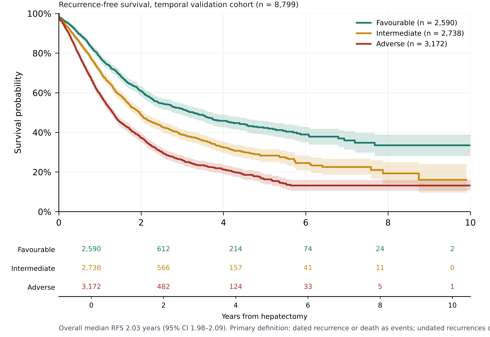
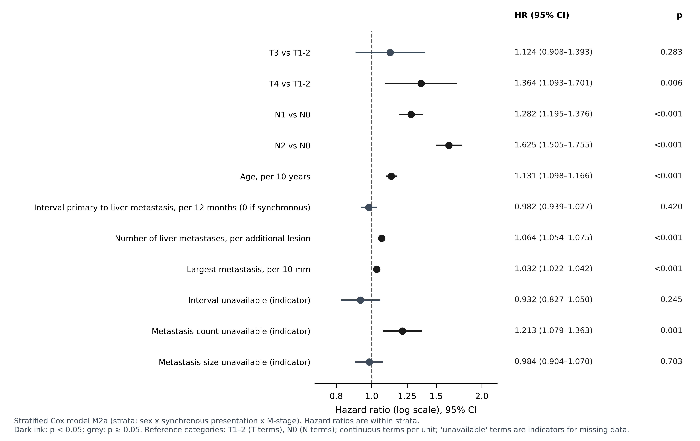
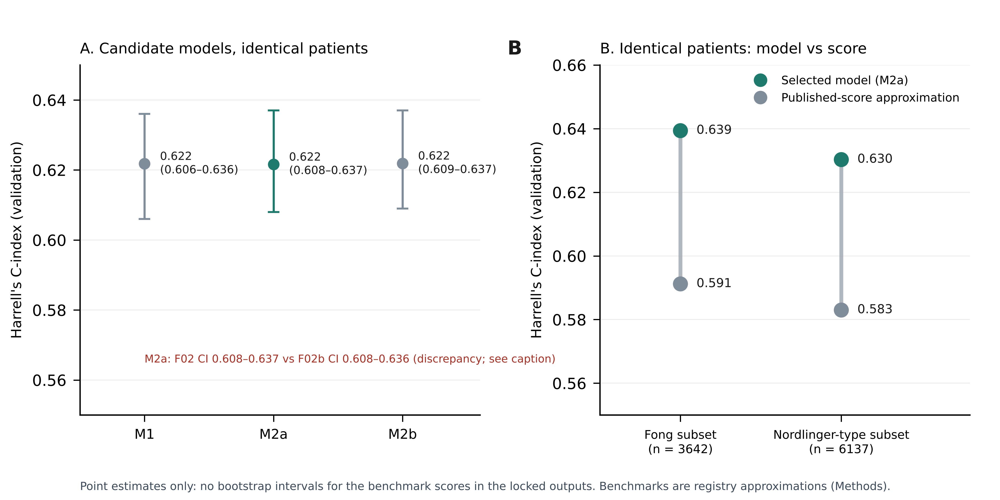

# Supplementary Material — Paper 1

All tables are generated from the locked v8 outputs (`results/final_v7`) and the Paper 1 coefficient outputs (`results/final_v9/paper1`). No model was re-estimated.

## Table S1. Included versus excluded patients

Sources: `F32` (characteristics) and `F65` (standardised mean differences).

| Characteristic | Included (n = 17,262) | Excluded (n = 8,832) |
|---|---|---|
| Patients | 17,262 | 8,832 |
| Age at operation, years, median (IQR) | 63.4 (55.7-70.6) | 63.0 (55.3-69.9) |
| Male sex, n (%) | 10,676 (61.8) | 5,333 (60.4) |
| Synchronous presentation, n (%) | 10,015 (58.0) | 3,674 (41.6) |
| Number of liver metastases known, n (%) | 16,011 (92.8) | 7,068 (80.0) |
| Largest recorded metastasis known, n (%) | 13,956 (80.8) | 6,425 (72.7) |
| Pre-operative CEA recorded, n (%) | 11,364 (65.8) | 4,898 (55.5) |
| Deaths recorded, n (%) | 6,601 (38.2) | 3,705 (41.9) |
| Deaths inside the 15-year window (events), n (%) | 6,591 (38.2) | 3,696 (41.8) |
| Median overall survival, years (KM) | 4.15 | 3.84 |

| Characteristic | Included | Excluded | Standardised mean difference |
|---|---|---|---|
| Age at operation, years | 63.4 (IQR 55.7-70.6; n=15,271) | 63.0 (IQR 55.3-69.9; n=7,416) | 0.051 |
| Male sex | 61.9% (n=17,246) | 60.4% (n=8,827) | 0.031 |
| Synchronous presentation | 58.7% (n=17,064) | 44.8% (n=8,210) | 0.282 |
| Number of liver metastases (known) | 2.0 (IQR 1.0-3.0; n=16,011) | 2.0 (IQR 1.0-3.0; n=7,068) | 0.017 |
| Largest metastasis, mm (known) | 30.0 (IQR 20.0-45.0; n=13,956) | 35.0 (IQR 20.0-50.0; n=6,425) | -0.186 |
| Pre-operative CEA, ng/mL (known) | 7.2 (IQR 2.8-25.0; n=11,364) | 9.7 (IQR 3.2-41.0; n=4,898) | -0.029 |
| Operation year | 2010.0 (IQR 2007.0-2013.0; n=17,262) | 2007.0 (IQR 2001.0-2011.0; n=8,832) | 0.584 |
| Metachronous: interval unavailable | 55.9% (n=7,049) | 66.2% (n=4,536) |  |

## Table S2. Missing TNM components and exclusion patterns

**S2a. Missing components among the 26,094 patients meeting criteria** (`investigation/F45`).

| Missing components | n | % of 26,094 |
|---|---|---|
| none (complete) | 17262 | 66.2 |
| T + N + M | 3041 | 11.7 |
| T | 2324 | 8.9 |
| M | 1358 | 5.2 |
| T + N | 1220 | 4.7 |
| T + M | 418 | 1.6 |
| N | 402 | 1.5 |
| N + M | 69 | 0.3 |

**S2b. Exclusion by operation period** (`F63`).

| Operation years | Included | Excluded | % excluded |
|---|---|---|---|
| 1990-1999 | 637 | 1466 | 69.7 |
| 2000-2004 | 1825 | 1514 | 45.3 |
| 2005-2009 | 5967 | 2353 | 28.3 |
| 2010-2014 | 6637 | 2472 | 27.1 |
| 2015-2020 | 2162 | 696 | 24.4 |

**S2c. Exclusion clustering by site and country** (`F64`; a site is a registry site code).

| Level | Units | No exclusions | Only exclusions | ≥50% excluded | Median patients per unit | % of exclusions in 10 largest |
|---|---|---|---|---|---|---|
| sites | 259 | 57 | 11 | 34 | 22 | 54.0 |
| countries | 52 | 3 | 1 | 7 | 89 | 81.6 |

**S2d. Outcomes of included and excluded patients by era** (`F66`).

| Era | Included n | Excluded n | Included 5-y KM | Excluded 5-y KM | Included median OS (y) | Excluded median OS (y) |
|---|---|---|---|---|---|---|
| all | 17262 | 8832 | 0.436 | 0.407 | 4.15 | 3.84 |
| development (<=2009) | 8463 | 5664 | 0.423 | 0.391 | 3.97 | 3.67 |
| validation (>=2010) | 8799 | 3168 | 0.466 | 0.505 | 4.5 | 5.25 |

**S2e. Observed/expected survival relative to a no-TNM model** (`F67`). Interpret with caution: this is a selection check, not a validation.

| Group | Period | n | Predicted 5-y (no TNM) | Observed 5-y KM | O/E |
|---|---|---|---|---|---|
| included (TNM complete) | development | 8463 | 0.411 | 0.423 | 1.028 |
| included (TNM complete) | validation | 8799 | 0.401 | 0.466 | 1.161 |
| excluded (TNM incomplete) | development | 5664 | 0.406 | 0.391 | 0.963 |
| excluded (TNM incomplete) | validation | 3168 | 0.399 | 0.505 | 1.266 |

## Table S3. Duplicate-record screen and sensitivity analyses

**S3a. Screen** (`F60`).

| Item | n |
|---|---|
| records in identical-content pairs | 46 |
| identical-content pairs | 23 |
| pairs meeting the probable-duplicate rule | 16 |
| pairs with copies at different countries | 16 |
| second copies of identical pairs inside the analytic cohort | 6 |
| near-duplicate groups (birth date, operation date, sex match; different content) | 55 |
| near-duplicate groups with both copies in the analytic cohort | 31 |
| near-duplicate groups with one copy in the analytic cohort | 11 |
| later records dropped in the broad sensitivity (birth date, operation date and sex match within the cohort) | 37 |

**S3b. Effect on validation results** (`F61`). Columns are the primary analysis and two sensitivity analyses. C-index and survival are for the validation cohort.

| Metric | Primary (locked) | Identical-pair second copies removed (6 in cohort) | Broad rule: later copies removed (37) |
|---|---|---|---|
| Analytic cohort (n) | 17262 | 17256 | 17225 |
| Development (n) | 8463 | 8461 | 8444 |
| Validation (n) | 8799 | 8795 | 8781 |
| Validation C-index | 0.6216 | 0.6216 | 0.6216 |
| Validation 5-y Kaplan–Meier survival | 46.6% | 46.6% | 46.7% |
| Validation O/E at 5 years | 1.143 | 1.142 | 1.145 |
| Cut-point, lower tertile (predicted 5-y survival) | 0.3793 | 0.3794 | 0.3785 |
| Cut-point, upper tertile (predicted 5-y survival) | 0.4756 | 0.4756 | 0.4753 |
| Validation Favourable / Intermediate / Adverse (n) | 2662 / 2824 / 3313 | 2660 / 2825 / 3310 | 2656 / 2833 / 3292 |
| Patients in the same group as primary (%) | — | 99.81 | 99.2 |
| Agreement with primary grouping (κ) | — | 0.997 | 0.988 |
| Patients reassigned to a different group | — | 33 | 138 |

## Table S4. Candidate models and proportional-hazards tests

**S4a. Candidate models on identical patients** (`F02`). Validation n = 8,799; 5-y observed survival 46.6%. Each row's bootstrap CI comes from its own 300 resamples drawn at a different point in the random stream, so the M2a upper bound here (0.637) can differ by 0.001 from the selected-model value (0.636, `F02b`, used in the text and Figure 1). See `results/final_v9/figure1/CI_discrepancy_investigation.md`.

| Model | Training C | Validation C | 95% CI | 5-y AUC | 5-y Brier | Mean predicted 5-y | O/E 5 y | Calibration slope |
|---|---|---|---|---|---|---|---|---|
| M1 stratified sex x synchronous (M-stage covariate) | 0.5947 | 0.6218 | 0.606-0.636 | 0.674 | 0.0651 | 0.409 | 1.141 | 1.091 |
| M2a stratified sex x synchronous x M-stage | 0.5952 | 0.6216 | 0.608-0.637 | 0.675 | 0.0651 | 0.408 | 1.142 | 1.074 |
| M2b stratified sex x synchronous, time-varying M-stage (2-year split) | 0.5947 | 0.6219 | 0.609-0.637 | 0.674 | 0.0651 | 0.409 | 1.14 | 1.091 |

**S4b. Schoenfeld tests, training cohort, constant terms** (`F03`); M-stage is the term of interest.

| Model | Term | Test statistic | p |
|---|---|---|---|
| M1 | AGE10_F | 0.2358 | 0.6273 |
| M1 | DFI12_F | 0.0414 | 0.8388 |
| M1 | DFI_NR | 0.0699 | 0.7915 |
| M1 | M1 | 4.6772 | 0.0306 |
| M1 | METS_F | 0.0212 | 0.8842 |
| M1 | METS_NR | 0.3786 | 0.5384 |
| M1 | N1 | 1.1821 | 0.2769 |
| M1 | N2 | 1.5238 | 0.217 |
| M1 | SIZE10_F | 1.8866 | 0.1696 |
| M1 | SIZE_NR | 0.0039 | 0.9499 |
| M1 | T3 | 1.9576 | 0.1618 |
| M1 | T4 | 0.6059 | 0.4363 |
| M2a | AGE10_F | 0.173 | 0.6775 |
| M2a | DFI12_F | 0.1371 | 0.7112 |
| M2a | DFI_NR | 0.0013 | 0.9714 |
| M2a | METS_F | 0.0375 | 0.8465 |
| M2a | METS_NR | 0.8387 | 0.3598 |
| M2a | N1 | 1.5465 | 0.2137 |
| M2a | N2 | 0.9072 | 0.3409 |
| M2a | SIZE10_F | 1.5 | 0.2207 |
| M2a | SIZE_NR | 0.0122 | 0.912 |
| M2a | T3 | 1.7976 | 0.18 |
| M2a | T4 | 0.5688 | 0.4508 |

**S4c. Time-varying M-stage (M2b)** (`F04`).

| Term | Coefficient | HR early | p (time variation) | HR late |
|---|---|---|---|---|
| M1 early coef | 0.1148 | 1.122 |  |  |
| M1 change after 2 years | -0.1508 |  | 0.20668107504738975 |  |
| M1 late HR | -0.036 |  |  | 0.965 |

**S4d. Selection rule** (`F05`): choose the simplest candidate whose constant-term tests all have p > 0.05 in training data. Selected: M2a.

## Table S5. Sensitivity analyses

**S5a. Date conventions and same-day deaths** (`F10`, validation cohort; primary = 15th of month, half-day rule).

| Date convention | Same-day rule | Analytic n | Validation C | Cut-point 1 | Cut-point 2 | Same groups (%) | κ |
|---|---|---|---|---|---|---|---|
| first day (1st) | half | 17265 | 0.6214 | 0.3793 | 0.4755 | 99.71 | 0.996 |
| first day (1st) | one | 17265 | 0.6214 | 0.3793 | 0.4755 | 99.71 | 0.996 |
| first day (1st) | quarter | 17265 | 0.6214 | 0.3793 | 0.4755 | 99.71 | 0.996 |
| first day (1st) | exclude_all | 17249 | 0.6221 | 0.3799 | 0.4761 | 99.62 | 0.994 |
| mid-month (15th, primary) | half | 17262 | 0.6216 | 0.3793 | 0.4756 | 100.0 | 1.0 |
| mid-month (15th, primary) | one | 17262 | 0.6216 | 0.3793 | 0.4756 | 100.0 | 1.0 |
| mid-month (15th, primary) | quarter | 17262 | 0.6216 | 0.3793 | 0.4756 | 100.0 | 1.0 |
| mid-month (15th, primary) | exclude_all | 17249 | 0.6221 | 0.3799 | 0.4762 | 99.62 | 0.994 |
| month-end | half | 17262 | 0.6217 | 0.3793 | 0.4756 | 99.98 | 1.0 |
| month-end | one | 17262 | 0.6217 | 0.3793 | 0.4756 | 99.98 | 1.0 |
| month-end | quarter | 17262 | 0.6217 | 0.3793 | 0.4756 | 99.98 | 1.0 |
| month-end | exclude_all | 17249 | 0.6222 | 0.3799 | 0.4762 | 99.64 | 0.995 |

**S5b. Same-day deaths without death flag** (`F19`).

| Analysis | Analytic n | Validation C | Same groups (%) | κ |
|---|---|---|---|---|
| primary: half-day, all same-day deaths kept | 17262 | 0.6216 | 100.0 | 1.0 |
| exclude same-day deaths without death flag | 17255 | 0.6226 | 99.63 | 0.994 |
| same-day deaths without flag treated as censored at half-day | 17262 | 0.6226 | 99.63 | 0.994 |

**S5c. Carcinoembryonic antigen** (`F13`).

| Analysis | Validation n | CEA HR per log unit | 95% CI | C without CEA | C with CEA |
|---|---|---|---|---|---|
| complete case | 5847 | 1.159 | 1.132-1.186 | 0.6276 | 0.648 |
| multiple imputation, 10 draws (development outcome-compatible; validation predictors only) | 8799 | 1.153 | 1.127-1.180 | 0.6224 | 0.6366 |

**S5d. Pre-operative-only models (no count or size)** (`F14`, `F23`).

| Model | Validation C | 95% CI | O/E 5 y | Calibration slope |
|---|---|---|---|---|
| pre-operative-only, M1 structure (no count or size) | 0.5913 | 0.573-0.606 | 1.126 | 1.358 |

| Model | Validation C | 95% CI | O/E 5 y | Calibration slope |
|---|---|---|---|---|
| pre-operative-only, selected M2a structure (no count or size) | 0.5905 | 0.575-0.604 | 1.128 | 1.307 |

**S5e. Recalibration from 2005–2009 baseline** (`F22`; coefficients fixed).

| Analysis | Mean predicted 5-y | O/E 5 y | Validation C | κ vs primary | % same group |
|---|---|---|---|---|---|
| primary (baseline from all training years) | 0.408 | 1.142 | 0.6216 |  |  |
| recent-baseline sensitivity (2005-2009) | 0.418 | 1.115 | 0.6197 |  |  |
| phenotype agreement of recent-baseline groups with primary |  |  |  | 0.883 | 92.2 |

**S5f. No-TNM model on the same patients** (`F62`). The TNM model is 0.6216 on the same 8,799 patients.

| Analysis | Development n | Validation n | Validation C | Note |
|---|---|---|---|---|
| same patients: TNM M2a (primary) | 8463 | 8799 | 0.6216 | reference |
| same patients: no-TNM model (complete-case development) | 8463 | 8799 | 0.5994 | difference TNM minus no-TNM = 0.0222, 95% CI 0.0094 to 0.0335 (paired bootstrap, 300 resamples) |
| broader: no-TNM model (all development patients), same 8,799 validation patients | 14127 | 8799 | 0.5982 | same patients as the primary validation set |
| broader: no-TNM model (all development patients), all validation patients | 14127 | 11967 | 0.5972 | includes patients with incomplete TNM; not comparable with the TNM model |

## Table S6. Death flags and the 15-year window

**S6a.** Sources: `F12`. The first block covers the full extract; the last rows cover the analytic cohort.

| Check | n |
|---|---|
| deceased (PATSTATC) | 11594 |
| deceased with any DEATHKYN_F = Yes | 8520 |
| deceased without any DEATHKYN_F = Yes | 3074 |
| alive/lost but DEATHKYN_F = Yes | 2 |
| LASTNDTC earlier than latest follow-up date | 9 |
| LASTNDTC later than latest follow-up date | 1 |
| modelling cohort with last contact before time zero | 0 |
| modelling deaths after censoring date 2020-07-04 | 0 |
| modelling cohort: deaths recorded (PATSTATC = Deceased) | 6601 |
| modelling cohort: deaths inside the 15-year window (events in the models) | 6591 |
| modelling cohort: deaths beyond 15 years (censored at 15 years) | 10 |
| modelling cohort: PATIENTS with follow-up beyond 15 years (all statuses; not a death count) | 69 |
| modelling cohort: of those patients, number who died | 10 |

**S6b. Death-flag rate by time from operation** (`F18b`).

| Time from operation | Deaths | Flag = yes | % flagged |
|---|---|---|---|
| same day | 13 | 6 | 46.2 |
| 1-30 days | 197 | 99 | 50.3 |
| 31-365 days | 1163 | 843 | 72.5 |
| 1-5 years | 4470 | 3648 | 81.6 |
| >5 years | 758 | 533 | 70.3 |

## Table S7. Reproduction check

Source: `F25`. Each quantity was reproduced from the notebook against the previously validated values.

| Check | This run | Previously validated | Result |
|---|---|---|---|
| selected model | M2a | M2a | PASS |
| cut-point q33 | 0.3793 | 0.3793 | PASS |
| cut-point q67 | 0.4756 | 0.4756 | PASS |
| primary cohort | 17262 | 17262 | PASS |
| M2a validation C | 0.6216 | 0.6216 | PASS |
| RFS primary median | 2.03 | 2.03 | PASS |
| pre-operative (M1 structure) validation C | 0.5913 | 0.5913 | PASS |
| Fong subset C | 0.6394 | 0.6394 | PASS |
| Nordlinger subset C | 0.6303 | 0.6303 | PASS |
| CEA complete-case HR | 1.159 | 1.159 | PASS |

## Table S8. Horizon feasibility, group events and recurrence-free survival

**S8a. Group events by horizon** (`G02`, validation).

| Group | Horizon (y) | n | Deaths before horizon | At risk at horizon |
|---|---|---|---|---|
| Favourable | 1 | 2662 | 98 | 1470 |
| Favourable | 3 | 2662 | 275 | 568 |
| Favourable | 5 | 2662 | 355 | 194 |
| Intermediate | 1 | 2824 | 151 | 1583 |
| Intermediate | 3 | 2824 | 469 | 534 |
| Intermediate | 5 | 2824 | 581 | 129 |
| Adverse | 1 | 3313 | 332 | 1701 |
| Adverse | 3 | 3313 | 800 | 472 |
| Adverse | 5 | 3313 | 912 | 118 |

**S8b. Centre-held-out feasibility** (`G04`). Descriptive only; no centre-held-out model was fitted for this manuscript.

| Minimum patients per site | Sites meeting threshold | Sites with ≥20 validation events | % of patients in qualifying sites | Countries meeting threshold |
|---|---|---|---|---|
| 20 | 122 | 32 | 95.5 | 37 |
| 50 | 78 | 32 | 87.0 | 27 |
| 100 | 51 | 29 | 76.0 | 22 |

**S8c. Recurrence-free survival handling rules** (`F17`).

| Rule | n | Events | Median (y) | 95% CI | 3-y RFS | 5-y RFS |
|---|---|---|---|---|---|---|
| PRIMARY: dated recurrence and death events; undated censored | 16677 | 8942 | 2.03 | 1.98-2.09 | 0.393 | 0.276 |
| undated recurrences events at last contact | 16677 | 9672 | 1.93 | 1.88-1.98 | 0.369 | 0.244 |
| undated recurrences events at mid-interval | 16677 | 9672 | 1.69 | 1.65-1.74 | 0.329 | 0.228 |
| undated recurrence patients excluded | 15001 | 7996 | 1.84 | 1.78-1.90 | 0.368 | 0.268 |

**S8d. Undated recurrence check** (`F11`).

| Group | n | Median age | T4 % | N2 % | M1 % | Median OS (y) | Deaths % |
|---|---|---|---|---|---|---|---|
| undated recurrence (count > 0, no date) | 1676 | 62.6 | 21.9 | 28.0 | 57.5 | 3.51 | 56.4 |
| dated recurrence after operation | 5324 | 62.6 | 21.7 | 30.4 | 62.9 | 3.95 | 50.6 |
| neither | 9677 | 64.3 | 21.3 | 25.6 | 55.0 | 5.41 | 27.6 |

## Table S9. Reporting checklists

See `Paper1_reporting_checklists.docx` (TRIPOD+AI primary; STROBE; PROBAST+AI status).

## Table S10. Benchmark comparison on identical validation patients

Source: `F16_identical_subset_comparison_calibration.csv`. Point estimates only; the benchmark scores are registry approximations (see Methods). Subset sizes are identical for the selected model and the score.

| Validation subset | n | Deaths | Selected model C-index | Observed/expected 5-y | Fong score C-index | Nordlinger-type C-index |
|---|---|---|---|---|---|---|
| All TNM-complete validation | 8799 | 1916 | 0.6216 | 1.142 | — | — |
| Fong CRS subset (CEA recorded) | 3642 | 914 | 0.6394 | 1.188 | 0.5912 | — |
| Nordlinger-type subset | 6137 | 1396 | 0.6303 | 1.155 | — | 0.583 |

## Supplementary figures

**Figure S1.** Recurrence-free survival by prognostic group in the temporal validation cohort (n = 8,799; primary definition: dated recurrence or death as events, undated recurrences censored). Kaplan–Meier curves with 95% confidence bands; numbers at risk beneath. Overall median RFS 2.03 years (95% CI 1.98–2.09).

**Figure S2.** Forest plot of the selected stratified Cox model (M2a) for overall survival. Points are hazard ratios and bars 95% confidence intervals (log scale). Hazard ratios are within strata defined by sex, synchronous presentation and M-stage. Dark ink: p < 0.05. Coefficients are in Table 2; the reference category for each term is shown in its label.

**Figure S3.** Discrimination. (A) Harrell's C-index in the validation cohort for the three candidate M-stage structures fitted on identical patients, with bootstrap 95% CIs from 300 resamples. (B) Selected-model C-index against published-score approximations on identical validation patients (Fong subset, n = 3,642; Nordlinger-type subset, n = 6,137); point estimates only. **[TO CONFIRM — DISCREPANCY]** The M2a upper confidence bound is 0.637 in the candidate table (F02) and 0.636 for the selected model (F02b). Both come from the same model with different bootstrap draws (Supplementary Table S4; CI_discrepancy_investigation.md). The manuscript reports the F02b value; the supervisor must confirm this choice.

## Coefficient outputs

Baseline survival by stratum (`P1_baseline_survival_by_stratum.csv`) and group summary (`P1_group_summary.csv`) are in `results/final_v9/paper1/`.

| stratum_sex_synchrony_Mstage | baseline_survival_1y_at_reference_covariates | baseline_survival_3y_at_reference_covariates | baseline_survival_5y_at_reference_covariates |
|---|---|---|---|
| 0 | 0.9762 | 0.8781 | 0.809 |
| 1 | 0.965 | 0.854 | 0.7572 |
| 2 | 0.9747 | 0.8698 | 0.802 |
| 3 | 0.9742 | 0.8852 | 0.8147 |
| 4 | 0.9765 | 0.8887 | 0.8082 |
| 5 | 0.967 | 0.8403 | 0.751 |
| 6 | 0.9771 | 0.8878 | 0.8008 |
| 7 | 0.9776 | 0.8919 | 0.8134 |

| group | development_n | validation_n | predicted_5y_survival_range_validation | mean_predicted_5y_validation |
|---|---|---|---|---|
| Favourable | 2821 | 2662 | 0.476-0.711 | 0.532 |
| Intermediate | 2821 | 2824 | 0.379-0.476 | 0.428 |
| Adverse | 2821 | 3313 | 0.000-0.379 | 0.291 |
