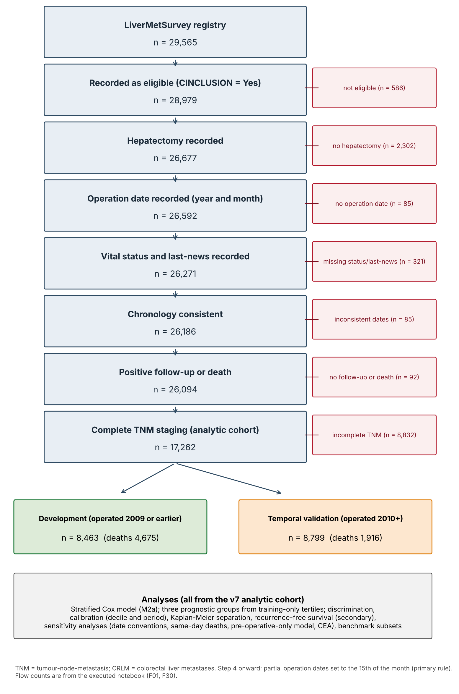
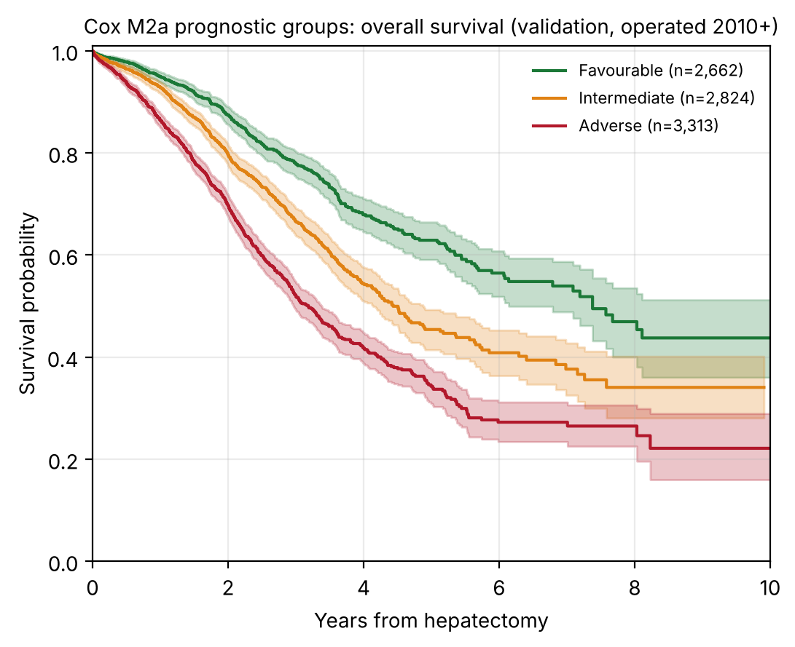
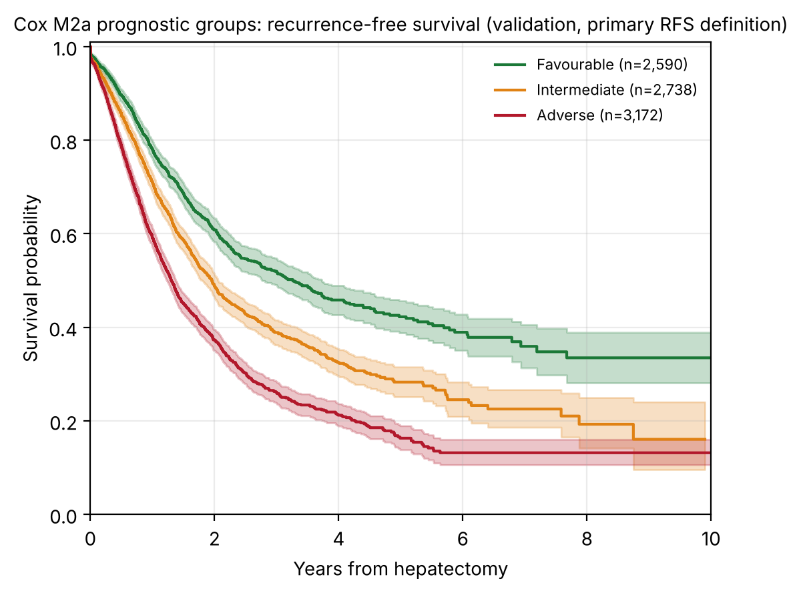
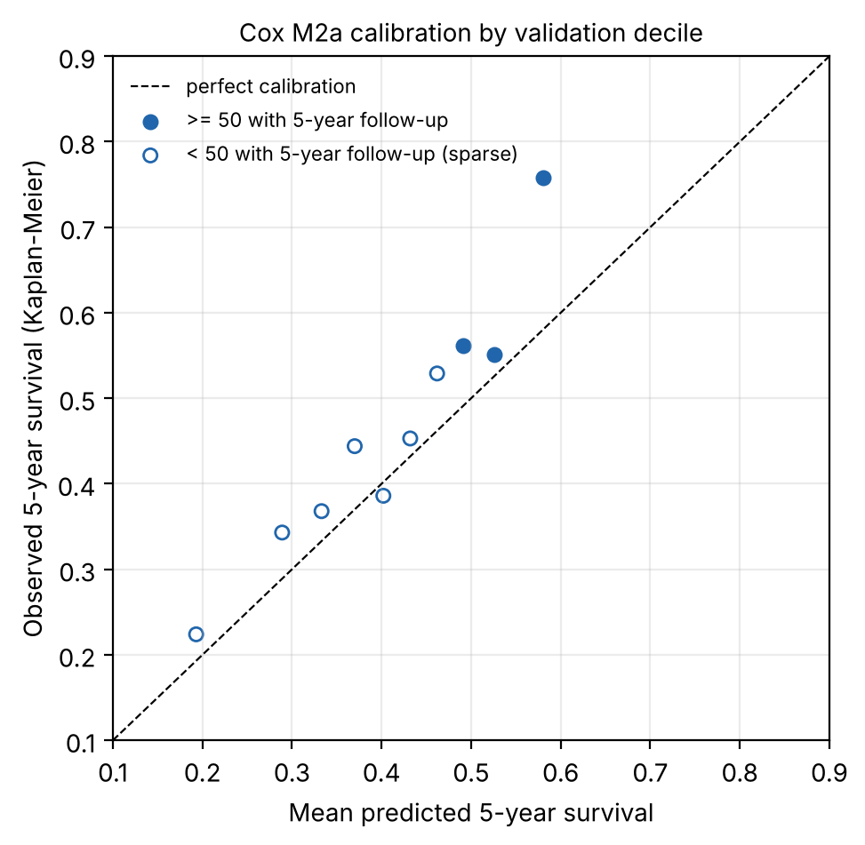
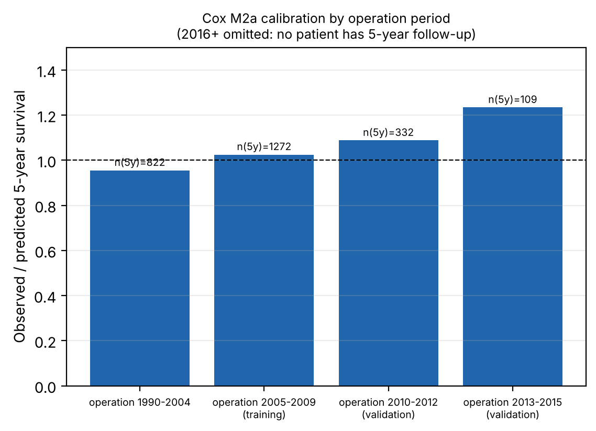

^1^School of Architecture, Computing and Engineering, University of East London, London E16 2RD, United Kingdom. ^2^NHS Grampian, Department of General Surgery, Aberdeen Royal Infirmary, Aberdeen AB25 2ZA, United Kingdom. ^3^East Lancashire Hospitals NHS Trust, Department of Hepatopancreaticobiliary Surgery, Burnley, Lancashire, United Kingdom. ^4^Centre Hépato-Biliaire, AP-HP Hôpital Universitaire Paul Brousse, Université Paris-Saclay, Villejuif, France.

\*Corresponding author: Farrah Aftab, MSc — f.aftab@uel.ac.uk

> **Draft for supervisor review.** Numbers are generated from the executed v7 notebook (`notebooks/LiverMets_final_reproducible_executed.ipynb`) and the descriptive script (`notebooks/descriptives_v7.py`). Items marked **[TO CONFIRM]** need action by the authors before submission.

# Abstract

**Background:** Colorectal liver metastases (CRLM) remain a major cause of colorectal cancer death. We developed a survival model and prognostic groups for hepatectomy patients with CRLM and evaluated them in temporal validation.

**Methods:** Retrospective analysis of the LiverMetSurvey international registry. The analytic cohort comprised 17,262 hepatectomy patients with complete TNM staging. Development used patients operated in 2009 or earlier (n = 8,463); temporal validation used patients operated in 2010 or later (n = 8,799). A stratified Cox model used TNM stage, age, interval from primary diagnosis to liver metastasis, and number and size of metastases. Prognostic groups were training-era tertiles of predicted 5-year survival. Performance was assessed by C-index, calibration and Kaplan–Meier separation.

**Results:** In validation, the Favourable (n = 2,662), Intermediate (n = 2,824) and Adverse (n = 3,313) groups had median overall survival of 7.38, 4.44 and 3.18 years (log-rank p = 2 × 10⁻⁵²). The C-index was 0.622 (95% CI 0.608–0.637) and the integrated Brier score 0.075. Predicted 5-year survival was lower than observed (40.8% vs 46.6%). Without metastasis count and size, the C-index was 0.591. A model without TNM staging gave a C-index of 0.599 on the same patients. Median recurrence-free survival was 2.03 years (95% CI 1.98–2.09).

**Conclusions:** A stratified Cox model using routinely recorded variables separated three prognostic groups that remained distinct in temporal validation. Discrimination was modest, survival was under-predicted in recent patients, and patients with incomplete staging differed systematically, raising concern about selection bias. Absolute estimates require recalibration before clinical use.

**Keywords:** colorectal liver metastases; prognostic model; Cox regression; survival analysis; temporal validation; calibration; surgical oncology

# Introduction

Colorectal cancer accounts for about 10% of global cancer diagnoses, and hepatic metastases develop in roughly half of patients with colorectal cancer [CITATION NEEDED]. Surgical resection, with or without perioperative chemotherapy, is the main opportunity for cure, yet long-term outcomes are difficult to predict for an individual patient. The Fong Clinical Risk Score was derived from a single-centre cohort more than two decades ago [1], and its threshold-based summation may not capture interactions between tumour biology variables [CITATION NEEDED].

Survival models that use the full time-to-event structure, including censored follow-up, are suited to prognostic stratification and to communicating expected survival over time [2,3]. Some machine learning studies in CRLM instead model a binary outcome, alive or dead, which discards timing information [CITATION NEEDED].

The LiverMetSurvey registry provides international, standardised data on patients resected for CRLM. This study aimed to: (1) define a survival model using routinely recorded variables; (2) derive prognostic groups using training-era cut-points only; (3) evaluate discrimination, calibration and separation in a later temporal validation cohort; (4) examine recurrence-free survival and the sensitivity of findings to date conventions, death-date handling and omission of metastasis count and size; and (5) compare performance with established scores on identical patients.

# Methods

## Study design and reporting

This was a retrospective cohort analysis of the LiverMetSurvey registry, a prospectively maintained, web-based database of patients with colorectal liver metastases established in 2004. The registry comprises 29,565 patients from 63 countries and 242 contributing centres. The study followed the STROBE guidelines [4] and the TRIPOD reporting recommendations for prognostic models [5]. The completed checklists are supplied with the submission **[TO COMPLETE]**. Analyses were run on the raw registry workbooks (Part 1 and Part 2) using a single scripted notebook. SHA-256 checksums of the workbooks were recorded to confirm that the source files were unchanged.

## Study population

Eligibility required: registry inclusion; hepatectomy recorded; an operation year and month; a vital status and last-news date on or after the operation date; and either positive follow-up or death. Patients with incomplete T, N or M staging were excluded from the analytic cohort. Figure 1 shows the flow. The analytic cohort comprised 17,262 patients. Of 29,565 registry records, 586 were not recorded as eligible, 2,302 had no hepatectomy recorded, 85 had no operation date, 321 had no vital status or last-news date, 85 had inconsistent chronology and 92 had neither follow-up nor death. Of the 26,094 patients remaining, 8,832 (33.8%) had incomplete TNM staging and were excluded from the analytic cohort. Those excluded patients are compared with the analytic cohort in Supplementary Tables S1 and S5.

Operation dates recorded to year and month only were assigned the 15th of the month (primary rule). The first-day and last-day-of-month rules were used as sensitivity analyses.

## Variables and definitions

* **Outcome:** overall survival (OS) from first hepatectomy to death from any cause or last-news date. Follow-up was capped at 15 years. No deaths in the analytic cohort occurred after 4 July 2020 (checked).
* **TNM stage:** T1–2, T3, T4; N0, N1, N2; M0, M1, using the AJCC staging categories [6,7] with sub-categories collapsed. T1–2, N0 and M0 are the reference categories.
* **Predictors:** age at operation (per 10 years); sex; synchronous presentation; interval from primary diagnosis to liver metastasis diagnosis (per 12 months; set to 0 for synchronous presentation and missing when the date was unknown, negative or after operation); number of liver metastases (continuous, 1–50); recorded liver metastasis size in mm (per 10 mm). Missing count and size were handled with missing-indicator variables and training-era medians.
* **Deaths and follow-up window:** 6,601 deaths were recorded in the analytic cohort. Of these, 6,591 occurred within the 15-year analysis window and are the events used in the models; the remaining 10 occurred beyond 15 years and were censored at 15 years. 69 patients in total had follow-up beyond 15 years: the 10 who died and 59 who were alive or lost to follow-up. The count of 69 is a number of patients, not of deaths.
* **Death:** status *Deceased* in the registry. Same-day deaths (operation date equal to last-news date) were assigned half a day of follow-up; other conventions were tested as sensitivity analyses.
* **Recurrence-free survival (RFS):** time from hepatectomy to the earliest dated recurrence after operation, or to death. Recurrences dated before operation were excluded. Undated recurrences were censored in the primary analysis and handled by three alternative rules.

## Uncertainty in recurrence dates and predictor timing

Two data-quality issues were quantified rather than assumed away. First, the interval predictor depends on two dates (primary diagnosis and liver-metastasis diagnosis). Second, the number of metastases recorded before operation may differ from the number found at resection. Both are reported in Results (Table 4) and handled as follows: missing intervals are represented by a missing-indicator term; the pre-operative-only model was fitted as a sensitivity analysis; and the operative-form count was compared with the pre-operative count on patients with both recorded. Recurrence dates that fall after the last contact were treated as undated, the notebook rule, and are reported separately.

## Model development

Patients operated in 2009 or earlier formed the development cohort; patients operated in 2010 or later formed the temporal validation cohort. Validation data were used only to evaluate fixed models, cut-points and rules.

Three candidate models were compared on identical patients: **M1**, stratified by sex and synchronous presentation with M-stage as a covariate; **M2a**, stratified by sex, synchronous presentation and M-stage; and **M2b**, as M1 with a time-varying M-stage effect split at 2 years. The selection rule was applied to training-only data: choose the simplest candidate whose Schoenfeld tests [8] for all constant terms have p > 0.05. M1 failed the test for M-stage (p = 0.031), so M2a was selected. Baseline hazards were estimated with a piecewise Breslow method [9] from training patients only.

## Prognostic groups

Patients were assigned to groups by predicted 5-year survival, using tertile cut-points estimated in the training cohort and applied unchanged to validation:

* Favourable: predicted 5-year survival ≥ 0.4756
* Intermediate: 0.3793 ≤ predicted 5-year survival < 0.4756
* Adverse: predicted 5-year survival < 0.3793

Separation was tested with log-rank tests and an ordinal C-index. Stability was assessed by refitting the model on 100 bootstrap samples and comparing the resulting assignments with the primary assignment (Cohen's κ).

## Performance and calibration

Harrell's C-index [10] was calculated in each cohort, with a 300-resample bootstrap interval in validation. Time-dependent AUC at 1, 3 and 5 years, Brier scores [11] at 1, 3 and 5 years, and the integrated Brier score over 1–7 years were computed in validation from training-based predictions. Calibration was assessed by comparing mean predicted 5-year survival with Kaplan–Meier 5-year survival [2] (observed/expected ratio), by a calibration slope, by validation decile and by operation period. Decile and period estimates were flagged as sparse when fewer than 50 patients had 5 years of follow-up.

## Sensitivity analyses

* **Partial operation dates:** first-day and month-end rules.
* **Same-day deaths:** half a day (primary), one day, quarter day, exclusion, and handling of same-day deaths without an explicit death flag (exclusion or censoring at half a day).
* **Pre-operative-only model:** metastasis count and size removed, fitted in the M1 and in the selected M2a structure.
* **Carcinoembryonic antigen (CEA):** complete-case analysis and multiple imputation (10 draws; development outcome included; validation predictors only).
* **Undated recurrences:** four RFS analyses.
* **Recent baseline:** baseline hazard re-estimated from 2005–2009 training patients with coefficients unchanged. Used only as a sensitivity analysis.

## Comparison with established scores

The Fong Clinical Risk Score [1] and a Nordlinger-type score [12] were compared with the selected model on identical patients. The Fong subset comprised patients with CEA recorded; the Nordlinger-type subset comprised patients with age, T stage, N stage and interval data. The Fong score was computed from its five items (node-positive, interval < 12 months, more than one metastasis, size > 50 mm, CEA > 200 ng/mL). The Nordlinger-type score is an approximation built from four items available in this registry (age ≥ 60, T4, node-positive, interval < 12 months) and is not the published model. Both comparisons are therefore indicative.

## Data quality, duplicate records and supplementary models

The registry has no patient-level identifier: the study identifier is constant and the subject identifier is blank. Records were therefore screened for duplicates using every analysis column together with country, site, centre and patient number. An identical-content pair is two records with identical values in every analysis column. A probable duplicate additionally shares birth date and operation date and has at least 20 non-blank fields. The primary analysis retains all records. Probable duplicates were removed only in a sensitivity analysis, and a broader sensitivity analysis removed later records sharing birth date, operation date and sex. No record was permanently removed, pending confirmation from the registry coordinators.

A model without TNM staging was fitted as a supplementary analysis. It used age, interval from primary diagnosis, metastasis count and size, with missingness indicators, stratified by sex and synchronous presentation. Its same-patient comparison used the same 8,463 development and 8,799 validation patients as the primary model, with a paired bootstrap of 300 resamples for the difference in C-index. A broader version was fitted on all development patients and evaluated on all validation patients, and is reported separately. Excluded patients were described by operation period, centre and country, by clinical characteristics and by outcomes. The no-TNM model was used to test whether their outcomes differed from what the recorded covariates predicted.

## Software and reproducibility

Random seed was 42. Software: pandas 2.3.3, NumPy 2.5.3, lifelines 0.30.3, scikit-survival 0.28.0, scikit-learn 1.9.1, pyarrow 26.0.0 and python-calamine 0.8.3, on Python 3.13.16. The notebook was executed end to end. A reproduction check against the previously validated analysis passed for all ten key quantities (`F25_reproduction_check_against_v6.csv`). The primary analysis outputs are unchanged from the validated version; the v8 additions are supplementary. The analysis was not optimised for the C-index: the model was selected by the pre-specified PH rule, and cut-points were fixed in training. The treatment comparison is not part of this version and is not reported.

# Results

## Study population

Of 29,565 registry patients, 28,979 were recorded as eligible, 26,677 had a hepatectomy recorded, 26,592 had an operation date, 26,271 had status and last-news recorded, 26,186 had consistent chronology and 26,094 had positive follow-up or death. Of these, 17,262 had complete TNM staging and formed the analytic cohort (Figure 1). Development contained 8,463 patients (4,675 deaths) and validation 8,799 patients (1,916 deaths).

**Figure 1.** STROBE patient flow. Counts are from the executed notebook (F01 and F30). Exclusions at each step are differences between consecutive counts.

Baseline characteristics of the analytic cohort are given in Table 1. The median age was 63.4 years (IQR 55.7–70.6), 61.8% were male, and 57.8% had M1 disease. Median follow-up was 3.16 years (reverse Kaplan–Meier). Patients in validation were more often M1 and had more metastases; the validation cohort had shorter follow-up.

| characteristic | Total (n=17,262) | Development (<=2009; n=8,463) | Validation (>=2010; n=8,799) |
|---|---|---|---|
| Patients | 17,262 | 8,463 | 8,799 |
| Age at operation, years, median (IQR) | 63.4 (55.7-70.6) | 62.9 (55.2-69.9) | 64.0 (56.2-71.4) |
| Male sex, n (%) | 10,676 (61.8) | 5,204 (61.5) | 5,472 (62.2) |
| T stage, n (%) |  |  |  |
|    T1-2 | 491 (2.8) | 186 (2.2) | 305 (3.5) |
|    T3 | 13,023 (75.4) | 6,592 (77.9) | 6,431 (73.1) |
|    T4 | 3,748 (21.7) | 1,685 (19.9) | 2,063 (23.4) |
| N stage, n (%) |  |  |  |
|    N0 | 5,709 (33.1) | 2,827 (33.4) | 2,882 (32.8) |
|    N1 | 6,784 (39.3) | 3,337 (39.4) | 3,447 (39.2) |
|    N2 | 4,769 (27.6) | 2,299 (27.2) | 2,470 (28.1) |
| M stage, n (%) |  |  |  |
|    M0 | 7,277 (42.2) | 3,686 (43.6) | 3,591 (40.8) |
|    M1 | 9,985 (57.8) | 4,777 (56.4) | 5,208 (59.2) |
| Synchronous presentation, n (%) | 10,015 (58.0) | 4,776 (56.4) | 5,239 (59.5) |
| Synchrony not recorded, n (%) | 198 (1.1) | 138 (1.6) | 60 (0.7) |
| Metachronous presentation, n (%) | 7,049 (40.8) | 3,549 (41.9) | 3,500 (39.8) |
| Interval primary to liver metastasis, months, median (IQR; metachronous only) | 16.0 (9.8-26.9) | 16.3 (10.1-27.5) | 15.8 (9.4-26.3) |
| Metachronous, interval unavailable (metastasis date unknown or after operation), n (%) | 3,941 (55.9) | 2,154 (60.7) | 1,787 (51.1) |
| Number of liver metastases, n (%) |  |  |  |
|    1 | 7,144 (41.4) | 3,626 (42.8) | 3,518 (40.0) |
|    2-3 | 5,332 (30.9) | 2,625 (31.0) | 2,707 (30.8) |
|    >=4 | 3,535 (20.5) | 1,600 (18.9) | 1,935 (22.0) |
|    Unknown | 1,251 (7.2) | 612 (7.2) | 639 (7.3) |
| Largest recorded metastasis, mm, median (IQR) | 30.0 (20.0-45.0) | 30.0 (20.0-48.0) | 29.0 (19.0-45.0) |
| Size missing, n (%) | 3,306 (19.2) | 1,344 (15.9) | 1,962 (22.3) |
| Pre-operative CEA recorded, n (%) | 11,364 (65.8) | 5,517 (65.2) | 5,847 (66.5) |
| Deaths recorded (PATSTATC = Deceased), n (%) | 6,601 (38.2) | 4,685 (55.4) | 1,916 (21.8) |
| Deaths inside the 15-year analysis window (events), n (%) | 6,591 (38.2) | 4,675 (55.2) | 1,916 (21.8) |
| Patients with follow-up beyond 15 years (censored; not deaths), n | 69 | 69 | 0 |
| Median follow-up, years (reverse Kaplan-Meier) | 3.16 | 5.89 | 1.47 |
| Median overall survival, years (KM, 95% CI not shown) | 4.15 | 3.97 | 4.50 |

**Table 1.** Baseline characteristics of the analytic cohort, by development and validation period. Source: `results/final_v7/F31_table1_baseline_characteristics.csv`.

Supplementary Table S1 compares the analytic cohort with patients who met steps 1–7 but had incomplete TNM staging (n = 8,832). Excluded patients were less often synchronous (41.6% vs 58.0%), and less often had metastasis size (72.7% vs 80.8% recorded) or CEA (55.5% vs 65.8%) recorded.

| characteristic | Analytic cohort (TNM complete, n=17,262) | Excluded, incomplete TNM (n=8,832) |
|---|---|---|
| Patients | 17,262 | 8,832 |
| Age at operation, years, median (IQR) | 63.4 (55.7-70.6) | 63.0 (55.3-69.9) |
| Male sex, n (%) | 10,676 (61.8) | 5,333 (60.4) |
| Synchronous presentation, n (%) | 10,015 (58.0) | 3,674 (41.6) |
| Number of liver metastases known, n (%) | 16,011 (92.8) | 7,068 (80.0) |
| Largest recorded metastasis known, n (%) | 13,956 (80.8) | 6,425 (72.7) |
| Pre-operative CEA recorded, n (%) | 11,364 (65.8) | 4,898 (55.5) |
| Deaths recorded, n (%) | 6,601 (38.2) | 3,705 (41.9) |
| Deaths inside the 15-year window (events), n (%) | 6,591 (38.2) | 3,696 (41.8) |
| Median overall survival, years (KM) | 4.15 | 3.84 |

**Supplementary Table S1.** Analytic cohort compared with patients meeting steps 1–7 but with incomplete TNM staging. Source: `results/final_v7/F32_supp_S1_included_vs_excluded.csv`.

## Patients excluded for incomplete staging

Among the 26,094 patients meeting steps 1–7, T, N and M were missing together in 3,041 (11.7%); T alone in 2,324 (8.9%); M alone in 1,358 (5.2%); T and N in 1,220 (4.7%); T and M in 418 (1.6%); N alone in 402 (1.5%); and N and M in 69 (0.3%) (Supplementary Table S2). Each missing component was recorded either as not determined (ND) or left blank, and no recorded code was unmapped.

The proportion excluded fell with time: 69.7% of operations in 1990–1999, 45.3% in 2000–2004, 28.3% in 2005–2009, 27.1% in 2010–2014 and 24.4% in 2015–2020. Of 259 centres with patients meeting steps 1–7, 57 had no excluded patients, 11 had only excluded patients and 34 had at least half of their patients excluded. The ten centres contributing most exclusions accounted for 54% of all exclusions (Supplementary Table S5). Excluded patients were less often synchronous (44.8% vs 58.7% of those with the variable recorded), had larger recorded metastases (median 35 vs 30 mm), were operated earlier (median year 2007 vs 2010), and more often had an unavailable interval among metachronous patients (66.2% vs 55.9%). Their 5-year overall survival was lower in the development era (39.1% vs 42.3%) and higher in the validation era (50.5% vs 46.6%). Using the no-TNM model, observed/expected 5-year survival was 1.03 and 1.16 for included patients in the development and validation eras, and 0.96 and 1.27 for excluded patients (Supplementary Table S5).

These patterns are difficult to reconcile with missingness that depends only on the recorded covariates, and they raise concern about selection bias. The direction of any bias cannot be determined from the registry, and the assumption cannot be verified. Supplementary Tables S2–S5 give the full comparison.

## Model selection and performance

The M-stage candidates gave near-identical performance on identical patients (Table 2). M1 violated the proportional hazards assumption for M-stage (p = 0.031), so M2a was selected by the pre-specified rule. In validation, time-dependent AUC was 0.639, 0.653 and 0.675 at 1, 3 and 5 years. Brier scores were 0.060, 0.101 and 0.065 at 1, 3 and 5 years, and the integrated Brier score over 1–7 years was 0.075.

**Table 2.** Candidate models on identical patients.

| Model | Training C | Validation C (95% CI) | 5-y observed S | 5-y mean predicted S | O/E (5-y) | Calibration slope |
|---|---|---|---|---|---|---|
| M1: stratified sex × synchronous; M-stage covariate | 0.595 | 0.622 (0.606–0.636) | 0.466 | 0.409 | 1.141 | 1.091 |
| **M2a: stratified sex × synchronous × M-stage (selected)** | **0.595** | **0.622 (0.608–0.637)** | **0.466** | **0.408** | **1.142** | **1.074** |
| M2b: time-varying M-stage | 0.595 | 0.622 (0.609–0.637) | 0.466 | 0.409 | 1.140 | 1.091 |

## Prognostic groups

The three groups were clearly separated in both cohorts (Table 3, Figures 2 and 3). In validation, log-rank p = 2.0 × 10⁻⁵² and the ordinal C-index was 0.603. Bootstrap refitting gave a median κ of 0.832 (95% range 0.778–0.894).

**Table 3.** Prognostic groups (M2a) with training-only cut-points.

| Group | Predicted 5-y survival | Development n | Validation n | Validation deaths | Median OS, years (95% CI) | 5-y OS (KM) | Mean predicted 5-y S (validation) |
|---|---|---|---|---|---|---|---|
| Favourable | ≥ 0.4756 | 2,821 | 2,662 | 383 | 7.38 (6.14–NE) | 0.629 | 0.532 |
| Intermediate | 0.3793–0.4755 | 2,821 | 2,824 | 598 | 4.44 (4.14–4.88) | 0.454 | 0.428 |
| Adverse | < 0.3793 | 2,821 | 3,313 | 935 | 3.18 (2.97–3.38) | 0.343 | 0.291 |

Development counts are tertiles of the training cohort. Source: `F06_phenotypes_counts_survival_calibration.csv`.

**Figure 2.** Overall survival by prognostic group in the validation cohort (operated 2010 or later).

**Figure 3.** Recurrence-free survival by prognostic group in the validation cohort (primary RFS definition).

## Calibration

Predicted 5-year survival was lower than observed in validation (40.8% vs 46.6%; O/E 1.14; calibration slope 1.07). Under-prediction was present in 9 of 10 validation deciles (Figure 4). In the top decile, observed 5-year survival was 75.8% against 58.0% predicted, and this decile had 80 patients with 5 years of follow-up. The first seven deciles each had fewer than 50 patients with 5 years of follow-up, so their observed values are imprecise.

By operation period, the observed/expected ratio was 0.96 for 1990–2004, 1.03 for 2005–2009 (training), 1.09 for 2010–2012 and 1.23 for 2013–2015 (Figure 5). The 2013–2015 estimate rests on 109 patients with 5 years of follow-up. No patient operated in 2016 or later had 5 years of follow-up, so calibration in that period cannot be assessed.

Re-estimating the baseline hazard from 2005–2009 patients reduced validation O/E to 1.115 (C-index 0.620) and kept 92.2% of patients in their primary group (κ 0.883). This did not remove the calibration gap, so the primary results are not recalibrated.

**Figure 4.** Calibration by validation decile of predicted 5-year survival. Open markers: fewer than 50 patients with 5-year follow-up.

**Figure 5.** Observed/expected 5-year survival by operation period. The 2016 onward period is omitted because no patient had 5-year follow-up.

## Uncertainty in recurrence dates and predictor timing

**Table 4.** Predictor-timing and recurrence-date audit (analytic cohort unless stated). Source: `F33_predictor_and_recurrence_date_audit.csv` and `F34_operative_vs_preoperative_metastasis_count.csv`.

| Item | n |
|---|---|
| Analytic cohort (TNM complete) | 17,262 |
| Liver metastasis diagnosed after operation (interval set missing), analytic cohort | 12 |
| Metachronous, interval unavailable: primary diagnosis date missing (first reason in order) | 3,618 |
| Metachronous, interval unavailable: liver metastasis date missing | 302 |
| Metachronous, interval unavailable: metastasis diagnosed before primary (negative) | 12 |
| Metachronous, interval unavailable: metastasis diagnosed after operation | 9 |
| Metachronous, interval available | 3,108 |
| Synchrony not recorded (not classed as either) | 198 |
| Liver metastasis diagnosed after operation, all patients meeting steps 1-7 | 25 |
| Dated recurrence before time zero (excluded from RFS), analytic cohort | 585 |
| Dated recurrence after operation and before last contact, analytic cohort | 5,324 |
| Recurrence recorded with a date after last contact (notebook counts these as undated), analytic cohort | 41 |
| Recurrence recorded without usable date (count > 0; notebook definition), analytic cohort | 1,676 |
| Analytic cohort with both pre-operative and resected metastasis counts | 14,189 |
| Resected count equals pre-operative count | 8,847 |
| Resected count greater than pre-operative count | 2,244 |
| Resected count less than pre-operative count | 3,098 |

*Interval predictor.* Of 7,049 metachronous patients, 3,108 (44.1%) had a usable interval, with median 16.0 months (IQR 9.8–26.9) in the metachronous group. The remaining 3,941 (55.9%) lacked a usable interval: 3,618 because the primary diagnosis date was missing, 302 because the metastasis date was missing, 12 because the metastasis preceded the primary, and 9 because the metastasis was dated after operation. The 198 patients with synchrony not recorded are a separate category. Patients without a usable interval received the training median together with a missing-indicator term. The interval coefficient therefore reflects patients with a usable interval, and predictions for patients without one depend on the imputed value and the indicator term.

*Metastasis count.* Among 14,189 patients with both a pre-operative and a resected metastasis count, the counts agreed in 8,847 (62.4%), the resected count exceeded the pre-operative count in 2,244 (15.8%), and it was lower in 3,098 (21.8%). This means the pre-operative count is not a reliable proxy for the number of lesions found at operation, which bears directly on the validity of the predictor (Limitations).

*Recurrence dates.* Of the analytic cohort, 5,324 patients had a dated recurrence after operation and before last contact, and 585 had a dated recurrence before operation, which was excluded from RFS. A further 41 patients had a recurrence dated after their last contact; these were classed as undated under the notebook rule. In total 1,676 patients had a recurrence recorded without a usable date. Their predicted 5-year survival was similar to that of other patients (0.414 vs 0.407 and 0.420), but their follow-up and death rates differed.

## Sensitivity analyses

**Table 5.** Sensitivity analyses (validation unless stated). Source: F10, F13, F14, F19 and F23.

| Analysis | Result |
|---|---|
| Partial date rule: first day of month | Cohort 17,265; C 0.621; phenotype agreement 99.7% (κ 0.996) |
| Partial date rule: month-end | Cohort 17,262; C 0.622; phenotype agreement 99.98% (κ 1.00) |
| Same-day deaths: half day, one day, quarter day (primary) | C 0.622; identical phenotypes at reported precision |
| Same-day deaths: all 13 in the cohort excluded | Cohort 17,249; C 0.622; agreement 99.6% (κ 0.994) |
| Same-day deaths without death flag (7) excluded | Cohort 17,255; C 0.623; agreement 99.6% (κ 0.994) |
| Same-day deaths without death flag censored at half a day | C 0.623; agreement 99.6% (κ 0.994) |
| Pre-operative-only model, M1 structure | C 0.591 (0.573–0.606); O/E 1.13; calibration slope 1.36; agreement 70% (κ 0.55) |
| Pre-operative-only model, selected M2a structure | C 0.591 (0.575–0.604); O/E 1.13; calibration slope 1.31; agreement 72% (κ 0.58) |
| CEA, complete case | HR 1.16 per log unit (95% CI 1.13–1.19); C 0.628 → 0.648 |
| CEA, multiple imputation (10 draws) | HR 1.15 (95% CI 1.13–1.18); C 0.622 → 0.637 |

*Same-day deaths.* Nineteen registry patients died on the day of operation; 13 are in the analytic cohort. Their operation dates are complete and each has one follow-up form. Six of the 13 carry an explicit death flag (`DEATHKYN_F = Yes`) and seven do not. Among deceased analytic-cohort patients the flag was positive for 50% of deaths at 1–30 days, 73% at 31–365 days, 82% at 1–5 years and 70% beyond 5 years. The seven unflagged same-day deaths are not supported by an explicit flag, but excluding or censoring them changes the C-index by 0.001 and the group assignment for about 0.4% of patients.

*Dates.* Using the first day of the month instead of the 15th changed 0.3% of group assignments.

## Duplicate records and the no-TNM model

The duplicate screen found 23 identical-content pairs (46 records). Sixteen pairs met the probable-duplicate rule: 15 between Brazilian site 387 and Bulgarian site 385, and one within Spanish centre 27. Six second copies lie in the analytic cohort (2 development, 4 validation). Removing them left the validation C-index at 0.6216, 5-year survival at 46.6% and observed/expected at 1.142. Thirty-three patients (0.2%) changed group, and the lower cut-point moved from 0.3793 to 0.3794 (Supplementary Table S3). In a broader sensitivity analysis that removed 37 later records sharing birth date, operation date and sex, the C-index was unchanged at 0.6216, 5-year survival was 46.7%, and 138 patients (0.8%) changed group, giving group sizes of 2,656, 2,833 and 3,292 in validation (primary 2,662, 2,824 and 3,313). Fifty-five further groups share birth date, operation date and sex but differ in content; 31 of these have both copies in the analytic cohort. Their identity cannot be established from the registry extract, so they were not removed.

On exactly the same validation patients (n = 8,799), the TNM model had a C-index of 0.6216 and the no-TNM model 0.5994, a difference of 0.022 (95% CI 0.009 to 0.034; Supplementary Table S4). A no-TNM model fitted on all development patients gave 0.5982 on the same 8,799 patients and 0.5972 on all 11,967 validation patients, including those with incomplete staging; the latter is not directly comparable with the TNM model.

## Recurrence-free survival

Median RFS was 2.03 years (95% CI 1.98–2.09), with 39.3% and 27.6% recurrence-free at 3 and 5 years (primary definition; 8,942 events in 16,677 patients). Alternative handling of undated recurrences gave medians of 1.93 years (undated recurrences as events at last contact), 1.69 years (mid-interval) and 1.84 years (undated recurrences excluded). RFS is a secondary outcome.

## Comparison with established scores

**Table 6.** Validation C-index on identical patients.

| Subset | n | Deaths | Selected model | Comparator | O/E (5-y) |
|---|---|---|---|---|---|
| Fong subset (CEA recorded) | 3,642 | 914 | 0.639 | Fong approximation 0.591 | 1.19 |
| Nordlinger-type subset | 6,137 | 1,396 | 0.630 | Nordlinger-type approximation 0.583 | 1.16 |

The comparators are approximations built from registry variables, not the published models, so the comparison is indicative only.

# Discussion

In this international registry, a stratified Cox model using TNM stage, age, the interval from primary diagnosis to liver metastasis, and the number and size of liver metastases separated patients into three prognostic groups. These groups remained distinct in a later temporal validation cohort. The model discriminated modestly (C-index 0.622), and on identical patients it discriminated better than the Fong and Nordlinger-type approximations.

Because the model is a survival model, each patient receives a predicted survival curve that can be stated at 1, 3 and 5 years. Group assignment was stable (κ 0.83), and the cut-points were fixed in training.

The model under-predicted survival in the validation era (observed 46.6% vs predicted 40.8% at 5 years). The gap was largest in the most favourable decile. This may reflect improving survival in more recent patients, but the evidence is limited: later periods have few patients with 5 years of follow-up, and recalibration from recent data reduced the gap only slightly. Absolute survival estimates should therefore not be quoted until the model has been recalibrated on contemporary data.

RFS was analysed as a secondary outcome. Its median ranged from 1.69 to 2.03 years depending on how undated recurrences were handled, so RFS conclusions depend on that assumption.

Metastasis count and size improved discrimination, but they are recorded around the time of operation, and the pre-operative and resected counts disagreed in about 38% of patients. The pre-operative-only model is a sensitivity analysis and is not a pre-operative decision tool.

Patients excluded for incomplete staging differed from the analytic cohort in period, synchrony, metastasis size and centre, and their outcomes differed from what the recorded covariates predicted, in opposite directions in the two eras. Exclusion was concentrated in early operations and in centres with poor staging completeness. This pattern raises concern about selection bias. The analytic cohort is therefore the population in which TNM-based prediction is valid, but it is not representative of all resected patients, and its survival estimates should not be extended to patients with incomplete staging without caution. The no-TNM model confirms that TNM staging adds about 0.02 to discrimination on the same patients, but it does not remove the selection concern.

# Limitations

1. **Calibration and absolute survival.** The model under-predicts 5-year survival in the validation era (O/E 1.14). Recalibration from recent data reduced but did not remove the gap. The groups rank patients consistently, but their absolute survival values should be interpreted with caution.
2. **Limited late follow-up.** Patients operated from 2013 onward have few 5-year observations (109 for 2013–2015; none for 2016 onward). Period-specific calibration is provisional.
3. **Predictor timing and missingness.** The interval predictor is unavailable for 3,941 of 7,049 metachronous patients (55.9%), mostly because the primary diagnosis date is missing. Its effect is therefore estimated from a minority of metachronous patients, and results should be read with this in mind.
4. **Metastasis count and size.** These are recorded around operation, and the pre-operative and resected counts agreed for only 62% of patients with both recorded. The pre-operative-only model shows how much discrimination depends on these variables (C-index 0.591 vs 0.622).
5. **Recurrence dates.** 1,676 recurrences have no usable date, and 41 are dated after last contact. RFS is therefore secondary and depends on the handling rule.
6. **Death data.** Among 11,594 deceased patients, 3,074 have no death flag, so survival times for these patients rest on the last-news date. The death flag is missing or "No" at every follow-up interval: among deceased patients in the analytic cohort it reads Yes for 50% of deaths at 1–30 days, 73% at 31–365 days, 82% at 1–5 years and 70% beyond 5 years. Seven unflagged same-day deaths are included in the primary analysis; excluding them made no material difference.
7. **Comparators.** The Fong and Nordlinger-type scores are approximations built from registry variables, not the published models.
8. **Treatment effects.** Treatment comparisons are not included in this version. They have not been re-analysed in the final pipeline and must not be inferred from these results.
9. **Missing covariates.** CEA was recorded for 65.8% of patients. Complete-case and multiple-imputation results were similar, and the CEA contribution to C-index was about 0.02.
10. **Selection and missing staging.** Patients with incomplete staging (8,832; 33.8% of those meeting the eligibility steps) differ systematically in period, centre, synchrony and metastasis size, and their outcomes differ from what the recorded covariates predict (Supplementary Table S5). Whether staging was missing at random cannot be verified, and the observed patterns raise concern about selection bias. The analytic cohort is not representative of all resected patients.
11. **Possible duplicate records.** Sixteen probable duplicate pairs and 31 near-duplicate groups inside the analytic cohort await registry confirmation. Sensitivity analyses that remove them leave the primary conclusions unchanged (Supplementary Table S3), but the primary analysis retains all records until the registry confirms them.
12. **Registry and design.** Validation is temporal within a single registry, and no external validation was performed. Molecular markers and performance status were not present in the extract analysed.

# Conclusions

In an international registry of patients undergoing hepatic resection for CRLM, a stratified Cox model based on TNM stage, clinical and operative variables produced three prognostic groups with clearly different survival. The groups were stable and remained distinct in temporal validation, with modest discrimination. The model under-predicted survival in more recent patients, so absolute survival estimates require recalibration on contemporary data. Prospective validation is needed before clinical use.

# Declarations

**Funding:** No specific funding was received for this study.

**Conflicts of Interest:** The authors declare that they have no competing interests relevant to this work.

**Author Contributions:** F.A. conceived and designed the study, performed the statistical analyses, interpreted the data, and drafted the manuscript. M.A.G. supervised the study, contributed to the study design and interpretation of the findings, and critically revised the manuscript. M.B. provided clinical expertise, contributed to the interpretation of the clinical findings, and critically reviewed the manuscript. All authors read and approved the final manuscript. **[TO CONFIRM]** The original statement does not record a contribution for R. Adam. The authors must confirm each author's contribution before submission; no contribution has been added on their behalf.

**Data Availability:** The data analysed in this study were obtained from the LiverMetSurvey international registry. Access to the registry is governed by the LiverMetSurvey collaboration and is subject to institutional approval, data-sharing agreements, and applicable ethical requirements. Requests for data access should be directed to the registry coordinating centre. The analysis code is available at https://github.com/FarrahAftab/LiverMets.

**Ethics Approval:** This study was conducted in accordance with the principles of the Declaration of Helsinki. The study involved secondary analysis of anonymised data obtained from the LiverMetSurvey international registry. The registry contains de-identified clinical data collected in accordance with local ethical and regulatory requirements at participating centres. Owing to the retrospective analysis of anonymised registry data, the requirement for individual informed consent was waived where permitted by applicable regulations. Institutional ethical review was conducted in accordance with University of East London research governance requirements. **[TO CONFIRM]** No approval reference number is given in the original statement. Add the approval reference, or state that it is not applicable, before submission.

# References

1. Fong Y, Fortner J, Sun RL, Brennan MF, Blumgart LH. Clinical score for predicting recurrence after hepatic resection for metastatic colorectal cancer: analysis of 1001 consecutive cases. Ann Surg. 1999;230(3):309–318.
2. Kaplan EL, Meier P. Nonparametric estimation from incomplete observations. J Am Stat Assoc. 1958;53(282):457–481.
3. Cox DR. Regression models and life-tables. J R Stat Soc B. 1972;34(2):187–220.
4. von Elm E, Altman DG, Egger M, et al. The Strengthening the Reporting of Observational Studies in Epidemiology (STROBE) statement: guidelines for reporting observational studies. PLoS Med. 2007;4(10):e296.
5. Collins GS, Reitsma JB, Altman DG, Moons KGM. Transparent reporting of a multivariable prediction model for individual prognosis or diagnosis (TRIPOD): the TRIPOD statement. Ann Intern Med. 2015;162(1):55–63. **[TO CHECK]**
6. Edge SB, Compton CC. The American Joint Committee on Cancer: the 7th edition of the AJCC cancer staging manual and the future of TNM. Ann Surg Oncol. 2010;17(6):1471–1474.
7. Amin MB, Greene FL, Edge SB, et al. The 8th edition AJCC cancer staging manual: continuing to build a bridge from a population-based to a more "personalized" approach to cancer staging. CA Cancer J Clin. 2017;67(2):93–99.
8. Schoenfeld D. Partial residuals for the proportional hazards regression model. Biometrika. 1982;69(1):239–241.
9. Breslow NE. Discussion of "Regression models and life-tables" by D. R. Cox. J R Stat Soc B. 1972;34(2):216–217. **[TO CHECK]**
10. Harrell FE Jr. Regression Modeling Strategies. 2nd ed. Springer; 2015.
11. Graf E, Schmoor C, Sauerbrei W, Schumacher M. Assessment and comparison of prognostic classification schemes for survival data. Stat Med. 1999;18(17–18):2529–2545.
12. Nordlinger B, Guiguet M, Vaillant JC, et al. Surgical resection of colorectal carcinoma metastases to the liver. A prognostic scoring system to improve case selection. Cancer. 1996;77(7):1254–1262.

# Supplementary tables

**Supplementary Table S2.** Missing T, N and M components among patients meeting steps 1–7 (n = 26,094). Source: `F45`, `F46`.

| missing_components | n | pct_of_step7 |
|---|---|---|
| none (complete) | 17262 | 66.15 |
| T + N + M | 3041 | 11.65 |
| T | 2324 | 8.91 |
| M | 1358 | 5.2 |
| T + N | 1220 | 4.68 |
| T + M | 418 | 1.6 |
| N | 402 | 1.54 |
| N + M | 69 | 0.26 |

| component | raw | reason | n |
|---|---|---|---|
| T | ND | ND | 3617 |
| T | blank | blank | 3379 |
| T |  |  | 7 |
| N | ND | ND | 3599 |
| N | blank | blank | 1125 |
| N |  |  | 8 |
| M | ND | ND | 3320 |
| M | blank | blank | 1559 |
| M |  |  | 7 |

**Supplementary Table S3.** Possible duplicate records and sensitivity analyses (validation unless stated). Source: `F60`, `F61`.

| item | n |
|---|---|
| records in identical-content pairs | 46 |
| identical-content pairs | 23 |
| pairs meeting the probable-duplicate rule | 16 |
| pairs with copies at different countries | 16 |
| second copies of identical pairs inside the analytic cohort | 6 |
| near-duplicate groups (birth date, operation date, sex match; different content) | 55 |
| near-duplicate groups with both copies in the analytic cohort | 31 |
| near-duplicate groups with one copy in the analytic cohort | 11 |
| later records dropped in the broad sensitivity (birth date, operation date and sex match within the cohort) | 37 |

| analysis | analytic_n | validation_n | validation_C | validation_KM_5y | validation_O_over_E_5y | cut_S5_q33 | cut_S5_q67 | validation_Favourable_n | validation_Intermediate_n | validation_Adverse_n | pct_same_group_as_primary | kappa_vs_primary | reassigned_vs_primary |
|---|---|---|---|---|---|---|---|---|---|---|---|---|---|
| primary (locked) | 17262 | 8799 | 0.6216 | 0.4659 | 1.1425 | 0.3793 | 0.4756 | 2662 | 2824 | 3313 |  |  |  |
| identical-pair second copies removed | 17256 | 8795 | 0.6216 | 0.4659 | 1.1424 | 0.3794 | 0.4756 | 2660 | 2825 | 3310 | 99.81 | 0.9971 | 33.0 |
| later copies of birth/operation/sex matches removed (broad) | 17225 | 8781 | 0.6216 | 0.4668 | 1.1455 | 0.3785 | 0.4753 | 2656 | 2833 | 3292 | 99.2 | 0.988 | 138.0 |

**Supplementary Table S4.** Model without TNM staging: same-patient comparison and broader result. Source: `F62`.

| analysis | development_n | validation_n | validation_C | note |
|---|---|---|---|---|
| same patients: TNM M2a (primary) | 8463 | 8799 | 0.6216 | reference |
| same patients: no-TNM model (complete-case development) | 8463 | 8799 | 0.5994 | difference TNM minus no-TNM = 0.0222, 95% CI 0.0094 to 0.0335 (paired bootstrap, 300 resamples) |
| broader: no-TNM model (all development patients), same 8,799 validation patients | 14127 | 8799 | 0.5982 | same patients as the primary validation set |
| broader: no-TNM model (all development patients), all validation patients | 14127 | 11967 | 0.5972 | includes patients with incomplete TNM; not comparable with the TNM model |

**Supplementary Table S5.** Patients with incomplete staging by operation period, centre and country, characteristics, outcomes and informative-selection check. Source: `F63`–`F68`.

*Operation period*

| operation_years | analytic_n | excluded_n | pct_excluded |
|---|---|---|---|
| 1990-1999 | 637 | 1466 | 69.7 |
| 2000-2004 | 1825 | 1514 | 45.3 |
| 2005-2009 | 5967 | 2353 | 28.3 |
| 2010-2014 | 6637 | 2472 | 27.1 |
| 2015-2020 | 2162 | 696 | 24.4 |

*Centres and countries*

| level | units | units_no_exclusions | units_only_exclusions | units_50pct_or_more_excluded | median_patients_per_unit | pct_of_exclusions_in_10_largest_units |
|---|---|---|---|---|---|---|
| sites | 259 | 57 | 11 | 34 | 22 | 54.0 |
| countries | 52 | 3 | 1 | 7 | 89 | 81.6 |

*Characteristics, included versus excluded*

| characteristic | included | excluded | SMD |
|---|---|---|---|
| Age at operation, years | 63.4 (IQR 55.7-70.6; n=15,271) | 63.0 (IQR 55.3-69.9; n=7,416) | 0.051 |
| Male sex | 61.9% (n=17,246) | 60.4% (n=8,827) | 0.031 |
| Synchronous presentation | 58.7% (n=17,064) | 44.8% (n=8,210) | 0.282 |
| Number of liver metastases (known) | 2.0 (IQR 1.0-3.0; n=16,011) | 2.0 (IQR 1.0-3.0; n=7,068) | 0.017 |
| Largest metastasis, mm (known) | 30.0 (IQR 20.0-45.0; n=13,956) | 35.0 (IQR 20.0-50.0; n=6,425) | -0.186 |
| Pre-operative CEA, ng/mL (known) | 7.2 (IQR 2.8-25.0; n=11,364) | 9.7 (IQR 3.2-41.0; n=4,898) | -0.029 |
| Operation year | 2010.0 (IQR 2007.0-2013.0; n=17,262) | 2007.0 (IQR 2001.0-2011.0; n=8,832) | 0.584 |
| Metachronous: interval unavailable | 55.9% (n=7,049) | 66.2% (n=4,536) |  |

*Outcomes by era*

| group | included_n | excluded_n | included_deaths_pct | excluded_deaths_pct | included_KM_5y | excluded_KM_5y | included_KM_median_y | excluded_KM_median_y |
|---|---|---|---|---|---|---|---|---|
| all | 17262 | 8832 | 38.2 | 41.9 | 0.436 | 0.407 | 4.15 | 3.84 |
| development (<=2009) | 8463 | 5664 | 55.4 | 55.0 | 0.423 | 0.391 | 3.97 | 3.67 |
| validation (>=2010) | 8799 | 3168 | 21.8 | 18.5 | 0.466 | 0.505 | 4.5 | 5.25 |

*Informative-selection check (no-TNM model)*

| group | period | n | predicted_5y_no_TNM | observed_5y_KM | O_over_E |
|---|---|---|---|---|---|
| included (TNM complete) | development | 8463 | 0.411 | 0.423 | 1.028 |
| included (TNM complete) | validation | 8799 | 0.401 | 0.466 | 1.161 |
| excluded (TNM incomplete) | development | 5664 | 0.406 | 0.391 | 0.963 |
| excluded (TNM incomplete) | validation | 3168 | 0.399 | 0.505 | 1.266 |

*Logistic model for TNM completeness (odds ratios)*

| term | odds_ratio_complete_TNM | CI_low | CI_high | p |
|---|---|---|---|---|
| const | 0.954 | 0.7978 | 1.141 | 0.6063 |
| operated_2010_or_later | 1.7501 | 1.6585 | 1.8468 | 0.0 |
| synchronous | 1.9395 | 1.8368 | 2.0479 | 0.0 |
| age_per_10y | 1.0506 | 1.0233 | 1.0788 | 0.0002 |
| male | 1.0664 | 1.0103 | 1.1256 | 0.0198 |
| largest_metastasis_per_10mm | 0.955 | 0.9455 | 0.9645 | 0.0 |
| metastases_per_1 | 0.9871 | 0.9774 | 0.9969 | 0.0103 |

# Figure and table index

| Item | Source | Status |
|---|---|---|
| Figure 1 STROBE flow | `results/final_v7/figures/FIG1_STROBE_flow_v7.png` | Generated from v7 counts |
| Figures 2–5 | `results/final_v7/figures/COX_01–04*.png` | Generated from v7 notebook |
| Table 1 Baseline characteristics | `F31` | Generated from v7 cohort |
| Table 2 Candidate models | `F02` | From notebook |
| Table 3 Prognostic groups | `F06` | From notebook |
| Table 4 Predictor and recurrence audit | `F33`, `F34` | Generated from v7 cohort |
| Table 5 Sensitivity analyses | `F10`, `F13`, `F14`, `F19`, `F23` | From notebook |
| Table 6 Benchmarks | `F16` | From notebook |
| Supplementary Table S1 | `F32` | Generated from v7 cohort |
| Supplementary Table S2 | `F45`, `F46` | From v8 notebook |
| Supplementary Table S3 | `F60`, `F61` | From v8 notebook |
| Supplementary Table S4 | `F62` | From v8 notebook |
| Supplementary Table S5 | `F63`–`F68` | From v8 notebook |
| Reproduction check | `F25` | 10 of 10 pass |
